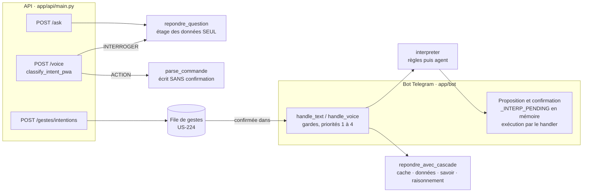
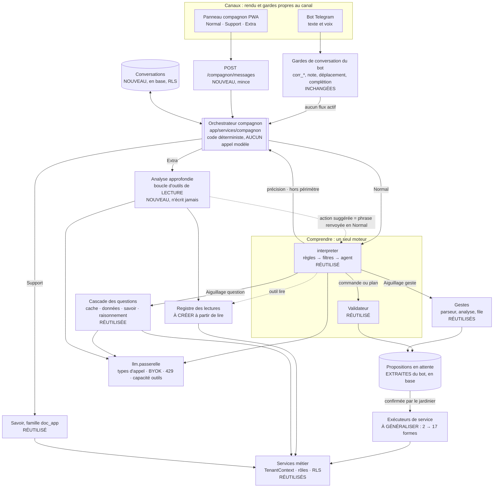

# Compagnon conversationnel : s'appuyer sur l'agent interpréteur sans créer un second moteur

> **Statut** : étude d'architecture du 21/10/2026. Aucun code n'a été modifié.
> Complétée le 24/10/2026 par le §16 (reprendre une action menée).
> **Vérifiée sur** : la branche `epic-13-agent-interpreteur`, arbre de travail du
> 21/10/2026 (v3.98.0). US-233 à US-238 y sont livrées, mais pas encore commitées.
> US-244 et US-245 sont en cours (`app/services/reponses_chiffrees.py` modifié).
> US-246 à US-249 sont spécifiées, sans code.
> **Référence** : [ARCHITECTURE_AGENT_INTERPRETEUR.md](../EPIC%20-%20AGENT%20INTERPRETEUR/ARCHITECTURE_AGENT_INTERPRETEUR.md)
> **Question posée** : comment le futur compagnon peut-il réutiliser l'agent
> interpréteur, les services métier et les mécanismes de validation, sans devenir
> un second agent qui en double les fonctions ?

---

## 0. L'essentiel en une page

**Ce qu'est l'agent aujourd'hui.** L'agent interpréteur **aiguille** les demandes
et **propose** des commandes ; il ne converse pas. Son prompt le dit
(`PROMPT_FIXE` : « Tu réponds en appelant des outils, jamais en texte »), il est
appelé avec `tool_choice="required"` et son catalogue est plafonné à 15 outils
(14 aujourd'hui). Ce prompt a été mesuré tel quel par US-233 et US-235. Pour en
faire l'interlocuteur du jardinier, il faudrait réécrire ce prompt, donc perdre
la mesure.

**Ce qu'il fait déjà.** Depuis US-236, il dit **où va** une phrase (question avec
sa nature, geste, précision, hors périmètre). Depuis US-237, il construit des
**plans**, exécutés par des **exécuteurs de service** et non par les handlers
Telegram. L'essentiel du « choix du bon traitement » existe donc et a été mesuré.
Il manque quatre choses, toutes **en dehors** de l'agent :

1. une **distribution indépendante du canal** : aujourd'hui, ce qui suit
   l'aiguillage est écrit dans `app/bot/messages.py` (priorités 3e à 4) ;
2. une **confirmation indépendante de Telegram** : la proposition en attente est
   gardée dans la mémoire du processus du bot (`_INTERP_PENDING`), et une
   commande seule s'exécute par l'introspection du handler Telegram ;
3. une **mémoire de conversation** : le contexte court d'US-238 n'existe que
   pendant qu'une proposition attend une réponse, et seulement dans le processus
   du bot. Elle doit retenir les échanges **et les actions menées**, avec leur
   référence en base, pour qu'une phrase puisse corriger ou annuler ce qui vient
   d'être fait (« j'ai oublié de dire que le semis datait du 5 mai », §16) ;
4. une **analyse approfondie** en lecture seule : la cascade répond à une
   question par un seul appel de raisonnement (400 jetons) qui reçoit au plus un
   texte de données.

**Le risque de deux moteurs existe déjà, côté API.** `POST /voice` classe la
phrase avec un second classifieur (`classify_intent_pwa`), puis écrit les
événements **sans confirmation**. `POST /ask` ne sert que l'étage des données de
la cascade, sans le savoir ni le raisonnement. L'historique `_sessions` est
enregistré mais n'est lu par rien. Un compagnon construit sur ces points
d'entrée reproduirait ces écarts.

**Recommandation : l'option B, sous une forme précise.** Un **orchestrateur
commun, écrit en code déterministe**, qui **n'appelle aucun modèle** et ne sert
pas les deux canaux de la même façon :

- côté PWA, toute la phrase passe par lui (`POST /compagnon/messages`) ;
- côté Telegram, il prend le relais là où s'arrêtent les gardes de conversation
  du bot (priorités 3e à 4 de `handle_text`).

En mode Normal, c'est l'agent interpréteur qui choisit le traitement. Les modes
Support et Extra sont choisis par le jardinier. Seule l'analyse du mode Extra
prend la forme de l'option C : un traitement séparé, **en lecture seule par
construction**, qui reprend les mêmes services et la même passerelle. Six règles
vérifiables (§14.2) empêchent deux moteurs concurrents. La première : **une
seule compréhension, un seul chemin d'écriture, une seule réponse aux
questions**.

**Modèles : un seul modèle tant qu'aucune mesure ne justifie d'en changer.** La
passerelle permet déjà un modèle par type d'appel (`GROQ_MODEL_<TYPE>`), sans
code. Avec la BYOK (US-186 / CA3), un potager n'a de toute façon **qu'un**
modèle. Le compagnon doit donc fonctionner avec un seul modèle et perdre ses
traitements un par un quand ce modèle ne suffit pas, sans que tout s'arrête.

---

## 1. De quel compagnon parle-t-on ?

Dans le dépôt, « compagnon » désigne **le bot Telegram** : le « compagnon de
terrain » d'US-091, et la fiche de corpus `compagnon-telegram.md`. La PWA n'a
**aucun** panneau de conversation (`frontend/src/` : aucune vue ni aucun
composant de chat). Ses boutons d'action déposent un geste dans la file d'US-224,
et c'est Telegram qui le confirme (arbitrage A16 des épics 9 à 12).

Le **compagnon conversationnel** étudié ici est le futur interlocuteur unique, à
la fois :

- dans la **PWA** : un panneau ouvert par un bouton flottant, comme sur les
  captures de référence fournies (« Gleba ») ;
- dans **Telegram** : le bot actuel, qui doit profiter des mêmes évolutions.

Les captures de référence montrent trois **modes choisis par l'utilisateur**,
un historique des conversations, une nouvelle conversation et un affichage
agrandi :

| Mode de la référence | Ce qu'il promet | Ce qui lui correspond dans l'application |
|---|---|---|
| **Normal** | Dialogue libre | Toute phrase : commande, geste, question. C'est le flux actuel du bot |
| **Support** | Aide à l'usage de l'outil | Le corpus `data/connaissance/doc_app/` (US-099), servi par l'étage du savoir |
| **Extra** | « Analyse croisée météo, sols, cultures, verger et comptabilité, **sans modifier tes données** » | Rien aujourd'hui. Les données existent : météo, caractéristiques des parcelles, cultures, rotation, calendrier, récoltes, ventes de plants. Le verger et la comptabilité, eux, n'existent pas dans l'application |

Le libellé du mode Extra contient une exigence d'architecture : **une analyse
n'écrit jamais**. Le §5.4 en fait une propriété de construction, pas une
consigne donnée au modèle.

---

## 2. Cartographie vérifiée des composants

### 2.1 Les couches

| Couche | Composant | Fichier | Rôle | Lié à un canal ? |
|---|---|---|---|---|
| Canal | Gardes de conversation du bot | `app/bot/messages.py` (priorités 0 à 3d) | Modes `corr_*`, déplacement, note guidée, complétion, mode `ask`, confirmation de parcelle | **Telegram** (machines à états de dialogue) |
| Canal | Distribution après l'interprétation | `app/bot/messages.py:764-798` (priorités 3e, 3f, 4) | Appelle `interpreter()` et suit l'`Aiguillage`, sinon `classer_demande` | **Telegram**, alors que la logique ne l'est pas |
| Canal | Proposition, confirmation, exécution | `app/bot/interpretation.py` | `_INTERP_PENDING` (l. 39), boutons `interp:ok:<id>` (US-234), exécution par introspection du handler (l. 371) | **Telegram** |
| Canal | Points d'entrée en langage naturel de l'API | `app/api/main.py` | `/voice` (l. 1964), `/ask` (l. 2129), `/parse`, `/gestes/intentions` (l. 1614) | Non, mais **divergents** (§2.5) |
| Comprendre | Interpréteur de commandes | `app/services/interpreteur_commandes.py:2561` | Règles (0 jeton), filtres de savoir et de geste annoncé, puis agent ou ancien repli | Non |
| Comprendre | Agent interpréteur | `app/services/agent/interpreteur_agent.py:230` (`proposer`) | Boucle bornée, outils typés, aiguillage, plan | Non |
| Comprendre | Catalogue d'outils | `app/services/agent/catalogue_outils.py:368` | 14 outils générés depuis les 38 formes de `FORMES_DICTABLES` | Non, mais le catalogue contient des formes propres à Telegram (§2.4) |
| Comprendre | Routeur | `llm/routeur.py` (`classer_demande`) | Règles, cache, puis modèle : ACTION ou l'une des trois natures de question | Non |
| Valider | Validateur | `app/services/agent/validation.py` | Ancrage selon la nature de la valeur, état simulé d'un plan | Non |
| Exécuter | Exécuteurs de service | `app/services/agent/executeurs.py:45` | `ResultatEtape` par étape, `require_role`, revalidation en base. **2 formes sur 17** | Non |
| Lire | Outil `lire` | `app/services/agent/lecture.py:73` | Parcelle, parcelles, lot, culture ; potager du contexte ; 30 résultats au plus | Non |
| Mémoire | Contexte court | `app/services/agent/contexte_court.py` | Proposition en attente et 3 échanges, pendant 300 s, rangés par `(user_id, potager_id)` | Non, mais **gardé dans la mémoire du processus** |
| Répondre | Cascade des questions | `llm/routeur.py:984` (`repondre_avec_cascade`) | Cache, données (gabarits puis agent SQL), savoir, raisonnement ; `routage_logs` ; 👍/👎 | Non |
| Répondre | Gabarits chiffrés | `app/services/reponses_chiffrees.py` | 21 agrégations à 0 jeton ; couverture mesurée à 17 questions sur 40 (US-243), en cours d'extension (US-244 à US-249) | Non |
| Répondre | Socle de connaissance | `app/services/connaissance.py` | Familles `doc_app`, `agronomie`, `memoire_potager` ; filtre d'isolation dans `_requete_base` | Non |
| Gestes | Parseur et analyse unifiée | `llm/parseur_deterministe.py`, `app/bot/saisie.py`, `enregistrement.py` | 97 % des gestes à 0 jeton ; confirmation dans le bot | Parseur : non. Confirmation : **Telegram** |
| Gestes | File de gestes en attente | `app/services/file_gestes.py` (US-224) | Geste pré-analysé, conservé trois jours, confirmé dans le bot | Non : c'est **le seul état en attente persistant et partagé entre canaux** |
| Métier | Services | `app/services/*.py` | Parcelles, événements, lots, échéances, calendrier, confiance, rotation, associations, bioagresseurs, pré-diagnostic, météo, stock, statistiques, vue des cultures, mémoire du potager | Non (règle US-041) |
| Socle | Contexte du potager | `app/services/context.py`, `potager_actif.py`, `ctx_pour_potager_consulte` (`main.py:352`) | `TenantContext(user_id, potager_id, role)` ; potager actif ou consulté | Non |
| Socle | Passerelle LLM | `llm/passerelle.py` | Types d'appel, `conso_tokens`, repli sur 429, mémoire des modèles sans outils, `_resoudre_client` (point d'entrée de la BYOK, l. 284) | Non |

### 2.2 Les points d'entrée et les interfaces de l'agent

| Interface | Signature | Ce qu'elle renvoie | Appelée par |
|---|---|---|---|
| `interpreteur_commandes.interpreter` | `(texte, ctx, autoriser_modele=True, contexte_court=None)` | `CommandeInterpretee \| Ambiguite \| Aiguillage \| Plan \| None` | `messages.handle_text`, `handle_voice` |
| `interpreteur_agent.proposer` | `(texte, ctx, contexte_court=None)` | `ResultatAgent(disponible, commande, aiguillage, plan, outils, motif, latence_ms, tokens)` ; ne lève jamais | `interpreter` quand `AGENT_MODE=actif` |
| `interpreteur_agent.observer` | `(texte, ctx)` | rien : écrit dans le journal en mode `ombre` | `interpreter` quand `AGENT_MODE=ombre` |
| `executeurs.executer_plan` / `executer_etape` / `revalider` | `(plan, ctx)` / `(db, ctx, commande)` | `tuple[ResultatEtape]` / `ResultatEtape` / motif ou `None` | `interpretation._plan_executer` |
| `interpreteur_commandes.recapitulatif` / `recapitulatif_plan` | `(commande)` / `(plan)` | Texte en Markdown Telegram (`*gras*`, « Équivalent tapé : `/…` ») | Bot |
| `interpreteur_commandes.journaliser` | `(commande \| plan, issue)` | ligne `routage_logs` | Bot |
| `contexte_court.construire` / `noter` | `(ctx, commande, ts, potager_id, …)` | `ContexteCourt` ou `None` | `interpretation.contexte_court_de` |

### 2.3 Les dépendances de l'agent

- `app.services.menu_commandes.FORMES_DICTABLES` : la source du catalogue
  d'outils, de leurs types et des drapeaux `destructrice` et `confirmation` ;
- `parcelles.CHAMPS_FICHE` et `vocabulaires_fiche()` : les champs typés de
  `parcelle_modifier` ;
- `llm.passerelle.appeler_chat_outils` : type d'appel `agent`, modèle
  `GROQ_MODEL_AGENT`, paramètre `historique` (US-237) ;
- `llm.routeur` : les trois natures de question rendues par `poser_question` ;
- `utils.parcelles` (`get_all_parcelles`, `resolve_parcelle`) et
  `database.db.SessionLocal` ;
- `app.config` : `AGENT_MODE` (`off` par défaut dans le code) et
  `AGENT_MAX_TOURS` (3).

### 2.4 Les liens avec Telegram qui empêchent de réutiliser l'agent tel quel

| Lien | Où | Pourquoi la PWA ne peut pas s'en servir |
|---|---|---|
| Exécution d'une **commande seule** par le handler enregistré (CA9 d'US-172) | `interpretation._interp_executer` | Le handler attend un `Update` Telegram et répond par un message. Il ne renvoie rien d'exploitable. Seules 2 formes sur 17 ont un exécuteur de service |
| **Proposition en attente** | `_INTERP_PENDING[user_id]` | Rangée par identifiant Telegram dans la mémoire du processus du bot. L'API tourne dans un **autre processus** (`potager-prod` contre `potager-prod-bot`) |
| **Contexte court** | `contexte_court._VERROU` et le dictionnaire associé | Même processus, même mémoire. Il est perdu au redémarrage et invisible de l'API |
| **Complétion d'un argument manquant** (CA13 d'US-172) et choix d'un nom voisin | `_interp_etape_suivante`, boutons | Le dialogue passe par des boutons Telegram |
| **Formes propres à Telegram** dans le catalogue | `FORMES_DICTABLES` : `note`, `corriger`, `vendre`, `tts_on`, `tts_off`, `tts`, `help` | Elles ouvrent un parcours guidé ou un réglage du bot. Elles n'ont pas de sens dans la PWA |
| **Récapitulatif** | `recapitulatif()` | Markdown Telegram, et « Équivalent tapé » ne sert à rien dans un panneau web |

### 2.5 Ce que l'API sert déjà en langage naturel, et ce qui diverge



| Écart | Constat dans le code | Conséquence pour le compagnon |
|---|---|---|
| **Un deuxième classifieur** | `/voice` → `groq_client.classify_intent_pwa` (ACTION / INTERROGER), qui n'est ni le routeur ni l'agent | C'est déjà un second moteur de compréhension. À retirer, pas à réutiliser |
| **Une écriture sans confirmation** | `/voice` en ACTION et `/parse` → `parse_commande` → `creer_evenement_depuis_parse` | Contredit « le modèle propose, le code dispose » et l'arbitrage A16. Seule l'ancienne PWA (`static/index.html`) les appelle |
| **Une cascade tronquée** | `/ask` → `questions.repondre_question` : gabarits et agent SQL seulement. Ni savoir, ni raisonnement, ni `routage_logs`, ni 👍/👎 | Une même question reçoit une réponse plus pauvre dans la PWA que dans Telegram |
| **Une mémoire inutilisée** | `_sessions[session_id]` (l. 1382) : écrite à chaque `/voice`, lue par aucun traitement | Il n'existe aucune mémoire de conversation réelle à reprendre |
| **Un retour sans interface** | `POST /routage/{id}/retour` existe ; sa docstring note qu'« aucune vue Q&A n'existe encore côté PWA » | Ce point d'accroche est prêt pour le panneau |

---

## 3. Les limites du périmètre actuel, besoin par besoin

| Besoin du compagnon | Ce qui existe | Limite | Verdict |
|---|---|---|---|
| **Traiter une commande** | Agent N1 et N2, validateur, récapitulatif, confirmation liée à sa proposition, plans | Confirmation et exécution d'une commande seule liées à Telegram. Plans limités à `/parcelle ajouter` et `/parcelle modifier`. Suppression hors plan | **À adapter** : exécuteurs pour toutes les formes d'écriture, proposition gardée hors du processus |
| **Questions analytiques** | Cascade, étage 1 (21 gabarits et agent SQL) | Une question donne une réponse. Une seule famille par question, aucune composition (« compare mon rendement de tomates à l'an dernier, en tenant compte de la météo »). Couverture de 17 sur 40, en cours de correction | **Réutiliser**. La composition relève de l'analyse |
| **Dialogue sur plusieurs échanges** | Contexte court de l'agent : corriger ou prolonger une proposition, 300 s. Complétion CA13. Mode `ask` du bot | Aucune mémoire pour les questions (« et l'an dernier ? »). Mémoire du processus. Aucune conversation à rouvrir (l'historique de la référence) | **À créer** : conversations persistantes. Le format d'US-238 se réutilise, pas son stockage |
| **Reprendre une action menée** | `/corriger` (parcours guidé), `evenements.corriger_evenement` | Une action exécutée ne laisse aucune trace lisible par l'agent ; aucun outil de correction ; une correction dictée devient un nouveau geste (cas du 24/10/2026) | **À créer** : mémoire des actions menées, en base, et outils `corriger_action` / `annuler_action` (§16) |
| **Conseil horticole** | Savoir (corpus `agronomie`, mémoire du potager), raisonnement (`_PROMPT_FIXE_RAISONNEMENT` : jamais de dose ni de produit), pré-diagnostic déterministe | Personnalisation limitée à un texte de données (étage hybride) | **Réutiliser** tel quel pour une réponse en un échange |
| **Analyse approfondie** | Rien. Les services de lecture existent : météo, rotation, calendrier, confiance de semis, échéances de lots, vue des cultures, statistiques, stock | Aucun traitement ne croise plusieurs sources en plusieurs lectures | **À créer**, en lecture seule |
| **Actions métier** | 17 formes d'écriture, gestes (parseur, file), écrans PWA (`PATCH /parcelles`…) | Les gestes ne sont confirmés que dans le bot (A16). `/voice` contourne cette règle | **À adapter** (commandes) ; **arbitrage** pour les gestes (§14.4, C1) |

---

## 4. Les traitements que le compagnon doit pouvoir invoquer

Chaque traitement garde **son** contrat. L'orchestrateur les appelle ; il ne les
réécrit pas.

| # | Traitement | Déclencheur | Composant | Écrit ? | Modèle | Statut |
|---|---|---|---|---|---|---|
| T1 | Comprendre et aiguiller | Toute phrase libre en mode Normal | `interpreter()` (règles, filtres, agent) | Non | `agent` (sauf règle) | **Réutilisé** |
| T2 | Proposer une commande ou un plan | T1 renvoie une `CommandeInterpretee` ou un `Plan` | Validateur et récapitulatif | Non | — | **Réutilisé** ; récapitulatif à rendre structuré |
| T3 | Confirmer, puis exécuter | Clic du jardinier | Propositions en attente et exécuteurs de service | **Oui**, seul chemin | — | **À extraire du bot et à généraliser** |
| T4 | Saisir un geste | T1 renvoie `Aiguillage(geste)`, ou le parseur reconnaît un geste | Parseur déterministe, analyse unifiée, file de gestes | Oui, après confirmation | `parsing` (rare) | **Réutilisé** ; lieu de la confirmation à arbitrer |
| T5 | Répondre sur les données | `Aiguillage(question, QUESTION_DATA)` | `repondre_avec_cascade(decision=…)` | Non | Le plus souvent aucun | **Réutilisé** |
| T6 | Répondre sur le savoir ou conseiller | `Aiguillage(question, SAVOIR \| HYBRIDE)` | Cascade, étages 2 et 3 | Non | `question` | **Réutilisé** |
| T7 | Support (aide à l'application) | Mode Support, ou phrase de savoir sur l'application | `connaissance.rechercher(famille=FAMILLE_DOC_APP)` puis raisonnement | Non | `question` si le passage ne suffit pas | **Petite adaptation** : imposer la famille dans la cascade |
| T8 | Analyse approfondie | Mode Extra | Boucle d'outils de **lecture** sur les services | **Jamais** | nouveau type `analyse` | **À créer** |
| T9 | Demander une précision, dire « hors périmètre » | `Aiguillage(precision \| hors_perimetre)` | Message, journal (`issue = precision \| hors_perimetre`) | Non | — | **Réutilisé** |
| T11 | Corriger ou annuler une action menée | L'agent appelle `corriger_action` ou `annuler_action` sur une référence de la mémoire des actions (§16) | Validateur, récapitulatif avant / après, `evenements.corriger_evenement` | **Oui**, après confirmation | `agent` | **À créer** |
| T10 | Ouvrir un écran ou un parcours | Forme propre à un canal (`note`, `vendre`…), action suggérée | PWA : intention de navigation (US-195). Telegram : handler | Non | — | **Petite adaptation** côté PWA |

---

## 5. Choisir le bon traitement

### 5.1 Deux décideurs, et pas un de plus

1. **Le jardinier**, par le mode qu'il choisit (Normal, Support, Extra). C'est
   gratuit et fiable, et l'interface de référence le propose.
2. **L'agent interpréteur**, par ses outils terminaux, en mode Normal. C'est
   déjà mesuré : 31 propositions justes sur 31 sur le chemin de l'agent
   (US-235), mais un aiguillage à 78,6 % contre un seuil de 85 % sur
   l'échantillon d'US-233.

**Aucun troisième classifieur.** Pas de modèle « routeur de compagnon » placé
devant l'agent, et pas de règles par mots-clés dans l'orchestrateur.
`classify_intent_pwa` disparaît avec l'ancien `/voice`.

### 5.2 Mode Normal : la chaîne actuelle, sans les gardes propres à Telegram

```text
phrase → interpreter(texte, ctx, contexte_court=…)
   ├─ CommandeInterpretee / Ambiguite / Plan  → T2 puis T3
   ├─ Aiguillage(question, nature)            → T5 ou T6 (repondre_avec_cascade, decision=nature)
   ├─ Aiguillage(geste)                       → T4
   ├─ Aiguillage(precision | hors_perimetre)  → T9
   └─ None (agent off, indisponible, rejet)   → routeur.classer_demande, comme aujourd'hui (priorité 4)
```

C'est exactement ce que font les priorités 3e à 4 de `handle_text`. Le
déplacer dans un service ne change **rien** pour le bot, et l'ordre de ces
étages est déjà couvert par le CA9 d'US-236.

### 5.3 Mode Support : le corpus de l'application d'abord

La phrase va droit à la cascade avec la nature `QUESTION_SAVOIR` et la famille
`doc_app` imposée. Il n'y a ni classification ni agent. C'est le moins cher des
modes, et le seul dont tout le contenu est écrit à la main et vérifié par
`tests/test_us099_corpus_fonctionnement.py`.

### 5.4 Mode Extra : la lecture seule par construction

L'analyse est une boucle d'outils bornée, à l'image de celle d'US-237, mais :

- elle n'a reçu **que des outils de lecture**. Aucun outil d'écriture ne figure
  dans sa liste ; l'interdiction ne dépend donc d'aucune consigne ;
- elle produit du **texte**, avec `tool_choice="auto"` et une borne de tours et
  de jetons ;
- si elle conclut à une action (« passe la planche sud en paillage »), elle
  la rend **sous forme de phrase suggérée**. Le jardinier la renvoie en mode
  Normal, d'un bouton, et la phrase passe par T1, T2 et T3. **Le seul chemin
  d'écriture reste celui de l'agent interpréteur.**

### 5.5 Les passages d'un mode à l'autre

| Situation | Comportement |
|---|---|
| Question en mode Normal dont la réponse de la cascade est mince | Réponse de la cascade, puis un bouton « Approfondir » qui relance la question en mode Extra. Jamais d'escalade automatique : l'analyse coûte plusieurs appels |
| Commande dite en mode Extra ou Support | Le mode ne peut pas écrire. Le compagnon propose « Passer en mode Normal pour le faire ? » en reprenant la phrase |
| Question sur l'application en mode Normal | Inchangé : le filtre `_est_demande_de_savoir` et la cascade la servent déjà |

---

## 6. Ce qui se réutilise, ce qui s'adapte, ce qui se crée

| Composant | Verdict | Ce qui change | Qui en profite |
|---|---|---|---|
| `interpreter()`, agent, catalogue, validateur | **Réutilisé sans modification** | Rien. Le compagnon n'ajoute **aucune** consigne à `PROMPT_FIXE` | Bot et PWA |
| `repondre_avec_cascade` | **Réutilisé** | Paramètre facultatif de famille pour le mode Support | Bot et PWA |
| Services métier, `TenantContext`, `require_role`, RLS | **Réutilisés** | Rien | — |
| Passerelle | **Réutilisée** | Nouveau type d'appel `analyse`, pour imputer et mesurer séparément | Bot et PWA |
| `executeurs.py` | **À généraliser** | Un exécuteur par forme d'écriture (17), avec un test de parité avec le handler (déjà en place pour 2 formes) | **Bot** (plans plus larges, résultats exploitables) et PWA |
| Proposition en attente (`_INTERP_PENDING`) | **À extraire** dans un service persistant | Table des propositions : identifiant, `user_id`, `potager_id`, canal, contenu sérialisé, expiration, statut. Le bot s'y branche | **Bot** (survit à un redémarrage) et PWA |
| Distribution des priorités 3e à 4 | **À extraire** dans l'orchestrateur | Le bot l'appelle et ne fait plus que le rendu | Bot et PWA |
| `contexte_court` | **Format réutilisé, stockage remplacé** | Le résumé borné en JSON reste dans la partie variable du prompt ; les données passent en base | Bot et PWA |
| `lecture.lire` | **Devient une entrée du registre des lectures** | Même fonction, visible par l'analyse | Agent et analyse |
| Récapitulatif | **À structurer** | Renvoyer des lignes (libellé, valeur, unité, sens) que chaque canal met en forme | Bot et PWA |
| `/ask` | **À aligner** | Passer par `repondre_avec_cascade` | PWA, dès maintenant |
| `/voice`, `/parse`, `classify_intent_pwa`, `_sessions` | **À retirer** à terme | À remplacer par l'orchestrateur | Supprime le second moteur |
| Orchestrateur, conversations, analyse, registre des lectures | **À créer** | §14.3 | Bot et PWA |

---

## 7. Comparaison des trois options

### 7.1 Option A : le compagnon appelle directement l'agent interpréteur

**Ce que c'est.** L'agent devient l'interlocuteur unique. On lui donne un ton de
conversation, des outils de lecture analytiques, une mémoire, et le droit de
répondre en texte. Une version minimale, où le canal appelle `interpreter()`
puis suit lui-même l'aiguillage, revient à **écrire la distribution dans
chaque canal**, ce que fait déjà `messages.py`.

| Critère | Évaluation |
|---|---|
| Avantages | Un seul prompt, un seul catalogue, aucun code de distribution dans la version complète |
| Inconvénients | Casse le contrat mesuré : `tool_choice="required"`, jamais de texte, plafond de 15 outils, préfixe mis en cache. Mêle une tâche rapide et fréquente (aiguiller, p50 de 291 ms, environ 3 000 jetons) et une tâche longue et rare (analyser). Chaque phrase de Telegram que les règles ne reconnaissent pas paie le prompt complet. Un agent qui lit beaucoup de données du jardinier et propose des écritures dans la même boucle expose davantage aux injections |
| Changements | Réécriture de `PROMPT_FIXE`, `tool_choice="auto"`, catalogue au-delà de 15 outils, mémoire de conversation dans l'agent, `AGENT_MAX_TOURS` relevé |
| Risque de doublon | Faible dans le code, mais **l'agent cumule toutes les responsabilités**. Dans la version minimale : distribution recopiée par canal |
| PWA et Telegram | Telegram paie la latence et le coût de la conversation, y compris à la voix. Les mesures d'US-233 et d'US-235 ne valent plus |
| BYOK | Le modèle du jardinier doit tout réussir dans un seul prompt : outils, raisonnement long, conversation. Un modèle modeste fait **tout** tomber, sans perte progressive |
| Tests et maintenance | Un seul corpus, mais très gros. Toute retouche du prompt oblige à tout remesurer |
| Préférable si | Le catalogue reste petit, un modèle unique, fort et bon marché est disponible, et une mesure montre qu'un seul prompt tient tous les registres au-dessus des seuils. **Ce n'est pas le cas** : C2 à 88,9 % et C10 à 78,6 % sont déjà sous les seuils pour la seule interprétation |

### 7.2 Option B : un orchestrateur commun distribue vers des traitements spécialisés

**Ce que c'est.** Un service qui reçoit la demande, le mode et la conversation,
puis appelle T1 à T10. Il en existe deux variantes :

- **B-modèle** : un modèle routeur en tête. **Écartée** : ce serait un troisième
  classifieur, après le routeur et l'agent, qu'il faudrait mesurer à son tour,
  et il ferait concurrence à l'aiguillage d'US-236 ;
- **B-déterministe** : l'orchestrateur ne fait que suivre le mode choisi par le
  jardinier et l'aiguillage rendu par l'agent. **Recommandée.**

| Critère | Évaluation |
|---|---|
| Avantages | Chaque traitement garde son contrat, son budget, son modèle et ses tests. La sélection est celle déjà mesurée. Le bot en profite, puisque sa distribution **devient** l'orchestrateur. On peut avancer par étapes |
| Inconvénients | Il faut extraire la distribution de `messages.py` sans changer l'ordre des étages, rendre la proposition persistante, et accepter une couche de plus à comprendre |
| Changements | `app/services/compagnon/` (orchestrateur, propositions, conversations, analyse), exécuteurs généralisés, `POST /compagnon/…`, appel de l'orchestrateur depuis le bot à partir de la priorité 3e |
| Risque de doublon | Faible si les règles R1 à R6 (§14.2) sont respectées. Risque à surveiller : un orchestrateur qui accumule des règles par mots-clés. Le test R4 l'interdit |
| PWA et Telegram | Même traitement, même résultat. Seul le rendu change |
| BYOK | Chaque traitement passe par la passerelle. Les pertes se font traitement par traitement : sans outils, le mode Normal retombe sur les règles et le routeur (ce qui existe déjà), et le mode Extra se déclare indisponible (US-191 : jamais de repli silencieux) |
| Tests et maintenance | L'orchestrateur se teste sans modèle, avec des traitements simulés. Les tests existants restent. Un test vérifie que les deux canaux donnent le même résultat |
| Préférable si | Plusieurs traitements ont des contrats différents et deux canaux doivent se comporter de la même façon. **C'est le cas ici** |

### 7.3 Option C : une couche d'orchestration propre au compagnon, sur les services existants

**Ce que c'est.** Un agent compagnon distinct, avec son prompt et ses outils
(les services), qui reprend le validateur et les services mais **pas**
l'interpréteur.

| Critère | Évaluation |
|---|---|
| Avantages | Toute liberté dans la conception de la conversation. Très adaptée à l'analyse en lecture seule. N'alourdit pas l'agent mesuré |
| Inconvénients | **Deux façons de comprendre** « la serre n'est plus une pépinière » (l'agent et le compagnon) : la PWA et Telegram finissent par diverger. Deux prompts, deux corpus, deux catalogues. Les évolutions de l'agent ne profitent pas au compagnon. La tentation de donner au compagnon ses propres outils d'écriture ouvre un **second chemin d'écriture** |
| Changements | Un nouveau package d'agent, un nouveau catalogue, un nouveau corpus d'évaluation |
| Risque de doublon | **Élevé**, sauf si le compagnon s'interdit toute commande |
| PWA et Telegram | Telegram n'en profite pas, ou bien il faut le rebrancher, et la comparaison des deux moteurs se fait en production |
| BYOK | Même modèle pour les deux moteurs : aucun gain, deux prompts à faire passer sur le modèle du jardinier |
| Tests et maintenance | Deux évaluations à tenir à jour |
| Préférable si | Le compagnon **n'agit jamais**. C'est exactement le cas du mode Extra : l'option C est la bonne forme **pour ce seul traitement**, placé sous l'option B |

### 7.4 Synthèse

| Critère | A | B (déterministe) | C |
|---|:---:|:---:|:---:|
| Une seule compréhension des commandes | ✅ | ✅ | ❌ |
| Contrat et mesure de l'agent préservés | ❌ | ✅ | ✅ |
| Le bot profite des évolutions | 🔶 (au prix de la latence) | ✅ | ❌ |
| Un seul chemin d'écriture | ✅ | ✅ | 🔶 |
| Lecture seule de l'analyse par construction | ❌ | ✅ | ✅ |
| BYOK : pertes progressives | ❌ | ✅ | 🔶 |
| Coût d'une phrase ordinaire | ❌ | ✅ | ✅ |
| Effort de départ | 🔶 | 🔶 | ❌ |

---

## 8. Ce que changent les US-236 à US-238

Vérifié sur les fiches `backlog/US-236…238` et sur le code livré (PATCH_NOTES
v3.96.0 à v3.98.0). ⚠️ L'en-tête de l'architecture de l'agent dit encore
« US-236 à US-238 ne sont pas démarrées » : il n'est plus à jour.

| US | Ce qui est livré | Conséquence pour le compagnon | Ce qu'il reste à faire |
|---|---|---|---|
| **US-236** Aiguillage | Type `Aiguillage`, outils terminaux, `repondre_avec_cascade(decision=…)` (la nature n'est pas reclassée), priorité 3f de `messages.py`, issues `precision` et `hors_perimetre` dans `routage_logs` | **L'agent est déjà l'aiguilleur.** L'orchestrateur n'a rien à classer. Mais la distribution est écrite dans le code Telegram, d'où la nécessité de l'extraire. Les demandes hors périmètre journalisées forment le **backlog de fonctionnalités** du compagnon | Extraire la distribution. Une nature d'analyse dans `poser_question` n'est à envisager qu'après mesure (§14.4, C3). Limites consignées : le filtre « geste annoncé » passe avant l'agent, et le raccourci « modifier… » aussi |
| **US-237** Plans | `Plan`, `valider_plan` (état simulé), boucle bornée, outil `lire` (4 cibles), `executeurs.py` (2 formes, `require_role`, revalidation en base), compte rendu ✅ ❌ ⏭ | **Les exécuteurs de service sont la pièce qui libère la confirmation de Telegram.** Les généraliser profite à la PWA et élargit les plans du bot. `lire` est le premier élément du registre des lectures | Exécuteurs pour les 15 formes d'écriture restantes. Réévaluer le prompt, modifié depuis la mesure (consignes 6, 9 et 10). Corpus multi-étapes absent |
| **US-238** Contexte court | `contexte_court.py` : proposition en attente et 3 échanges, 300 s, rangés par `(user_id, potager_id)`, résumé JSON dans la partie variable. Le préfixe ne change pas quand rien n'attend | **Le format se réutilise** : un résumé borné, dans la partie variable, sans casser le cache. **Le stockage ne se réutilise pas** : il vit dans la mémoire du processus du bot, et seulement pendant qu'une proposition attend. US engagée sans mesure, sans corpus de suites de conversation | Stocker en base. Étendre le contexte aux questions (« et l'an dernier ? »). Constituer d'abord un corpus de suites |

**L'arbitrage A5 de l'architecture** (« l'agent sert-il aussi la PWA ? Pas
avant la phase 4 ») est levé, puisque la phase 4 est livrée.

---

## 9. Validation, confirmation, potager actif et cloisonnement des potagers

| Garantie | Où elle vit aujourd'hui | Ce que le compagnon en fait |
|---|---|---|
| Le modèle propose, le code dispose | `interpreteur_agent` : aucune écriture dans la boucle | Inchangé. L'analyse n'a aucun outil d'écriture |
| Ancrage selon la nature de la valeur | `validation.py` | Réutilisé tel quel. Une phrase suggérée par l'analyse est revalidée sur **ce que le jardinier envoie**, comme toute phrase |
| Récapitulatif, puis confirmation | `interpretation.py` (Telegram) | Service `propositions` : on exécute **exactement** ce qui a été affiché, jamais une nouvelle lecture de la phrase |
| Une proposition, un identifiant (US-234) | `callback_data` `interp:ok:<id>` | Identifiant gardé en base. La confirmation est consommée de façon atomique (passage `en_attente` → `confirmee` en une écriture conditionnelle) : impossible de l'exécuter deux fois |
| Le potager du moment | `pending["potager_id"]` | Gardé avec la proposition **et** avec la conversation. Un potager différent au clic donne « Demande expirée, rien n'a été fait » |
| Expiration | `_INTERP_TIMEOUT = 300` | Colonne `expire_le`, contrôlée au clic |
| Potager consulté (archivé, en lecture) | `ctx_pour_potager_consulte`, `PotagerArchiveError` | Les modes de lecture restent permis ; aucune proposition d'écriture |
| Rôle | `require_role` dans les services et les exécuteurs | Inchangé, contrôlé à l'exécution. Le validateur peut l'anticiper (règle 5) pour ne pas proposer à un lecteur ce qui lui sera refusé |
| Le modèle ne produit jamais un `potager_id` | Validateur, règle 6. `lecture.lire` ne prend que le `ctx` | Même règle pour toutes les lectures de l'analyse |
| Cloisonnement en base | RLS (`current_potager_id`), `_requete_base` du socle | Les nouvelles tables (conversations, propositions) portent `potager_id` et une politique RLS, vérifiées par `tests/test_us043_rls_isolation.py` |
| Un résultat d'outil est une donnée | Consigne 10 de l'agent | Même consigne dans le prompt d'analyse. Les notes du jardinier sont balisées comme des données |
| Conversation propre à chacun | US-238 / CA6 : rangée par `(user_id, potager_id)` | Une conversation n'est jamais partagée entre deux membres du même potager |
| Une action se désigne, elle ne se devine pas | Rien aujourd'hui | Le modèle ne reçoit que des références opaques (`A1`…) de la mémoire des actions ; une référence absente du contexte est un rejet ; l'identifiant en base ne lui est jamais montré (§16.4, §16.5) |
| Identité du canal | Garde de liaison Telegram (US-045), JWT dans l'API | Inchangé. L'orchestrateur reçoit un `TenantContext`, jamais un identifiant de canal |
| Journal | `routage_logs` (`issue_interpretation`, `outils_agent`) | Même journal, avec une colonne `canal`. Le taux de propositions refusées se lit par canal |

---

## 10. Faire profiter Telegram et la PWA des évolutions de l'agent

Une évolution de l'agent profite aux deux canaux **à quatre conditions** :

1. **Un seul point d'entrée.** Le bot et l'API appellent l'orchestrateur, et
   l'orchestrateur appelle `interpreter()`. Une nouvelle forme dans
   `FORMES_DICTABLES` devient un nouvel outil (génération) et, avec son
   exécuteur, une commande confirmable dans les deux canaux.
2. **Un seul catalogue mesuré.** Pas de catalogue d'outils par canal : il
   faudrait mesurer deux prompts. Une forme propre à Telegram (`note`, `vendre`,
   `tts`…) est traitée **au rendu** : dans la PWA, elle ouvre l'écran voulu
   (intention de navigation, US-195) ou propose d'ouvrir le bot (A16).
3. **Des canaux qui ne décident rien.** Ils mettent en forme (Markdown et
   claviers pour Telegram, JSON pour React) et gèrent leurs propres gardes de
   dialogue. Aucune règle métier.
4. **Un corpus partagé, joué dans les deux canaux.** Un test de parité fait
   passer les phrases des corpus d'US-172 et d'US-235 par le chemin du bot et
   par celui de l'API, et compare les résultats (même type, même commande,
   mêmes valeurs).

Les gabarits d'US-244 à US-249 en profitent automatiquement : ils sont servis
par la cascade, que les deux canaux appellent de la même façon dès que `/ask`
est aligné.

---

## 11. Faut-il une abstraction commune pour accéder aux outils métier ?

**Ce qui existe déjà et remplit ce rôle :**

| Registre | Ce qu'il déclare | Consommé par |
|---|---|---|
| `menu_commandes.FORMES_DICTABLES` | Les commandes : arguments, types, vocabulaires, destructrice ou non, confirmation | Menu du bot, interpréteur, catalogue d'outils |
| `catalogue_outils.generer_outils` | Projection en JSON Schema, avec contrôle de parité | Agent |
| `executeurs.SERVICES` / `EXECUTEURS` | Forme → service, test de parité avec le handler | Plans |
| `catalogue_sql.enregistrer` | Les agrégations des gabarits | Cascade, étage 1 |
| `connaissance.rechercher` | Recherche dans le corpus, avec isolation | Cascade, étage 2 |
| `lecture.lire` | 4 lectures pour préparer une commande | Agent |

**Conclusion : pas de nouvelle couche générique.** Ni une classe de base
« Outil » commune à tout, ni un serveur MCP, ni un cadriciel d'agents. Deux
extensions ciblées suffisent :

1. **Un registre des lectures** (`app/services/agent/outils_lecture.py`, déjà
   prévu par l'architecture §3.2). Chaque lecture est déclarée **une fois** :
   un nom, un schéma, une fonction `(ctx, arguments) → JSON compact` qui appelle
   un service existant (météo, rotation, calendrier, confiance, échéances,
   récoltes, stock, caractéristiques des parcelles, mémoire du potager).
   L'agent en voit un **sous-ensemble** (les 4 lectures de `lire`, pour rester
   sous 15 outils) ; l'analyse en voit davantage. Une même fonction ne peut
   donc pas donner un résultat différent selon le traitement qui l'appelle.
2. **Des exécuteurs pour toutes les formes d'écriture.** `EXECUTEURS` est déjà
   l'abstraction « forme → service ». Il suffit de la compléter, avec son test
   de parité.

---

## 12. Les modèles

### 12.1 Ce que chaque usage demande

| Usage | Ce qu'il exige | Fréquence et latence | Ce qui est mesuré | Type d'appel |
|---|---|---|---|---|
| **Interprétation des commandes** | Appel d'outils fiable, négations, aucun champ ajouté, peu de jetons | Chaque phrase que les règles ne reconnaissent pas. Voix : latence courte indispensable | US-233 : C1 90,2 %, **C2 88,9 % ❌**, C3 100 %, **C10 78,6 % ❌**, p95 1 263 ms. US-235 : 31/31, 0 destruction erronée, 3 067 jetons par appel. **Prompt modifié depuis** (US-237, US-238) | `agent` |
| **Dialogue général** | Reprendre une suite (« et l'an dernier ? ») | Chaque message d'une conversation | Rien | Aucun s'il est porté par le contexte. Sinon `classification` |
| **Utilisation d'outils pour analyser** | Enchaîner 3 à 8 lectures, raisonner sur du JSON | Rare, latence acceptée (« Analyse approfondie… ») | Rien | `analyse` (nouveau) |
| **Conseil horticole** | Rester fidèle au corpus, ne donner ni dose ni produit | Moyenne | Corpus `us098`, `us140`, avis 👍/👎 | `question` |
| **Analyse approfondie** | Contexte long, synthèse, honnêteté sur les données absentes | Rare | Rien | `analyse` |

### 12.2 Recommandation

- **Un seul modèle pour commencer** (`GROQ_MODEL`), comme aujourd'hui. Le
  mécanisme pour séparer existe sans code (`GROQ_MODELE_PAR_TYPE`).
- **Le nouveau type d'appel `analyse` sert à imputer et à mesurer**, pas à
  changer de modèle. Son coût doit se lire à part dans `conso_tokens`.
- **Changer de modèle pour un usage seulement si quatre conditions sont
  réunies** : cet usage a son corpus et ses seuils ; le modèle par défaut y
  échoue ; un autre modèle y réussit ; le surcoût est chiffré. C'est le
  protocole d'US-233 (`tools/evaluer_agent.py`), à reproduire pour l'analyse.
- **L'interprétation reste à réévaluer** avant tout passage de `AGENT_MODE` à
  `actif` (`tools/evaluer_interpreteur_agent.py`) : son prompt a changé depuis
  la mesure. Le compagnon ne doit pas en dépendre pour être livré, puisqu'avec
  `off` le mode Normal fonctionne avec les règles, l'ancien repli et le routeur.
- **La BYOK tranche la question à long terme.** Avec un seul modèle par potager
  (US-186 / CA3), toute stratégie à plusieurs modèles ne vaut que pour les
  potagers sans clé personnelle. Le compagnon doit donc **perdre ses
  traitements un par un** : la passerelle mémorise déjà les modèles sans outils
  (`_cle_capacite`). Sans outils, le mode Normal retombe sur les règles et le
  routeur, et le mode Extra annonce qu'il est indisponible avec cette
  configuration, sans jamais basculer en silence sur la plateforme (US-191).

---

## 13. Le schéma cible



**Ce qu'il faut lire dans ce schéma.** Une seule flèche mène à `Exécuteurs`, et
elle part de `Propositions`. Une seule boîte comprend les phrases libres
(`interpreter`). L'analyse ne rejoint l'écriture qu'en repassant par
`interpreter`, avec une phrase que le jardinier a choisi d'envoyer.

---

## 14. Recommandation d'architecture

### 14.1 L'option retenue

**Option B déterministe.** L'agent interpréteur y fait office d'aiguilleur pour
le mode Normal. L'analyse du mode Extra prend la forme de l'option C, en lecture
seule. Le compagnon n'est **pas** un second agent : c'est un **orchestrateur
sans modèle**, qui place, avant et après les traitements existants, ce qui
manque pour sortir de Telegram (persistance, confirmation, conversation, rendu
neutre).

### 14.2 Six règles pour ne jamais avoir deux moteurs concurrents

Chaque règle peut être vérifiée par un test, sur le modèle du test d'US-041
(aucun `db.query` hors de `app/services/`).

| # | Règle | Comment la vérifier |
|---|---|---|
| R1 | **Une seule compréhension.** Toute phrase libre passe par `interpreter()`. Aucun autre classifieur d'intention n'est appelé depuis un canal | Test d'AST : `classify_intent_pwa` n'est plus appelée nulle part ; l'orchestrateur est le seul à appeler `interpreter` |
| R2 | **Un seul chemin d'écriture.** Une écriture issue du langage naturel passe toujours par une proposition confirmée, puis par un exécuteur de service | Test : l'analyse n'importe ni `executeurs` ni un service d'écriture ; sa liste d'outils ne contient que des lectures |
| R3 | **Une seule réponse aux questions.** Le bot et la PWA appellent `repondre_avec_cascade` | Test de parité entre canaux sur le corpus de questions |
| R4 | **L'orchestrateur ne parle jamais au modèle** | Test d'AST : `app/services/compagnon/orchestrateur.py` n'importe pas `llm.passerelle` |
| R5 | **Les canaux ne décident rien** | Test : le même corpus donne le même résultat par le bot et par l'API |
| R6 | **Le compagnon ne modifie pas l'agent.** Aucune consigne propre au compagnon dans `PROMPT_FIXE`. Le contexte va dans la partie variable | `PROMPT_FIXE` est figé par un test, et toute modification renvoie à une nouvelle mesure |

### 14.3 Où placer le code

```text
app/services/compagnon/
  orchestrateur.py   le mode et l'aiguillage → un traitement ; aucun appel modèle (R4)
  propositions.py    la proposition en attente, en base : identifiant, potager, expiration,
                     consommation atomique ; reprend les règles d'US-234
  conversations.py   les échanges récents et les actions menées, en base ; résumé borné
                     au format d'US-238, références opaques des actions (§16)
  analyse.py         la boucle de lecture du mode Extra ; type d'appel « analyse »
app/services/agent/
  outils_lecture.py  le registre des lectures, partagé par l'agent et l'analyse
  executeurs.py      complété : une forme d'écriture, un exécuteur
```

L'orchestrateur rejoint `app/services/` pour la même raison que l'agent : il ne
doit dépendre d'aucun canal (architecture §3.2).

### 14.4 Les étapes conseillées

Chaque étape se livre seule et n'apporte de valeur visible qu'à partir de E3.
Ces étapes ne sont pas des US numérotées : le découpage en US se fera après
arbitrage.

| Étape | Contenu | Ce qui change pour le jardinier |
|---|---|---|
| **E0** | `/ask` passe par `repondre_avec_cascade` | La PWA reçoit les réponses de savoir et de raisonnement, avec le journal et 👍/👎 |
| **E1** | Extraire la distribution (priorités 3e à 4) dans `orchestrateur.py` ; le bot l'appelle | Rien. Le CA9 d'US-236 (ordre des étages) reste vert |
| **E2** | Propositions en base ; exécuteurs pour les 17 formes d'écriture ; récapitulatif structuré ; **mémoire des actions menées, `corriger_action` / `annuler_action`** (§16) | Bot : une proposition survit à un redémarrage, les plans s'élargissent ; « j'ai oublié de dire que c'était le 5 mai » corrige le geste qui vient d'être enregistré |
| **E3** | `POST /compagnon/messages` et panneau PWA en modes Normal et Support. Formes propres à Telegram rendues en intentions de navigation | Le compagnon apparaît dans la PWA |
| **E4** | Conversations en base, corpus de suites, contexte étendu aux questions | « Et l'an dernier ? » est compris dans les deux canaux. L'historique des conversations devient consultable |
| **E5** | Registre des lectures, analyse du mode Extra, type d'appel `analyse`, rapport de mesure dédié | Le mode Extra |
| **E6** | Retirer `/voice` (ACTION et INTERROGER), `/parse` et `classify_intent_pwa` dès que l'ancienne PWA (`static/`) n'en dépend plus | Plus aucune écriture sans confirmation |

### 14.5 Arbitrages à faire

| # | Question | Recommandation |
|---|---|---|
| C1 | Le compagnon de la PWA enregistre-t-il des gestes lui-même, ou garde-t-il l'arbitrage A16 (confirmation dans Telegram) ? | **Garder A16 au départ.** Le geste compris est déposé dans la file d'US-224, déjà persistante et partagée entre canaux. Une confirmation des gestes dans le navigateur ouvrirait un nouveau chemin d'écriture : c'est une décision à part |
| C2 | Les commandes (parcelle, culture, calendrier…) peuvent-elles être confirmées dans la PWA ? | **Oui, par les exécuteurs de service.** Pour une parcelle, l'exécuteur et `PATCH /parcelles` finissent dans la même fonction, `utils.parcelles.update_parcelle`. Mais l'exécuteur l'appelle directement, alors que l'écran passe par `svc_parcelles.modifier_parcelle`. En E2, chaque exécuteur doit appeler la fonction de `app/services/` déjà utilisée par l'écran, pour qu'une écriture n'ait qu'une seule entrée. À vérifier forme par forme |
| C3 | Le mode Extra peut-il être déclenché par l'aiguillage en mode Normal ? | **Non au départ** : seulement sur choix explicite, pour le coût et la latence, avec un bouton « Approfondir ». Ajouter une nature d'analyse à `poser_question` seulement après mesure |
| C4 | Combien de temps garder les conversations ? | Peu de temps, avec une purge (sur le modèle des 90 jours de `questions_cache`). À valider avec le dossier `docs/RGPD/` |
| C5 | Un catalogue d'outils par canal ? | **Non** : un seul catalogue mesuré, et les formes propres à un canal traitées au rendu |
| C6 | Le verger et la comptabilité de la référence | **Hors périmètre** : aucune donnée de ce type dans l'application, hormis les ventes de plants (US-032) |
| C7 | Le compagnon exige-t-il `AGENT_MODE=actif` ? | **Non.** Il fonctionne avec les règles, l'ancien repli et le routeur ; le mode `actif` l'améliore. Ne pas lier sa livraison au passage en `actif` |

---

## 15. Risques et parades

| Risque | Parade |
|---|---|
| L'orchestrateur accumule des règles par mots-clés et devient un troisième classifieur | R1 et R4, testées. Le mode vient du jardinier, la nature vient de l'agent |
| La PWA et Telegram se mettent à répondre différemment | R3 et R5 : test de parité entre canaux sur le corpus commun |
| Le compagnon fait évoluer le prompt de l'agent pour ses besoins | R6 : `PROMPT_FIXE` est figé par un test, et toute modification oblige à remesurer |
| Une analyse trop chère | Mode explicite, bornes de tours et de jetons, imputation au type `analyse`, aucune escalade automatique |
| Injection de consignes par les notes que l'analyse lit | Résultats balisés comme des données, aucun outil d'écriture, lectures limitées au potager du contexte |
| Un état perdu ou divergent entre le processus du bot et celui de l'API | Propositions et conversations en base, jamais dans la mémoire d'un processus |
| Une proposition confirmée deux fois (deux onglets, double clic) | Consommation atomique en base, retrait avant exécution |
| Un modèle BYOK sans outils | Capacité mémorisée par la passerelle ; les traitements tombent un par un ; message explicite, sans repli sur la plateforme |
| `/voice` continue d'écrire sans confirmation pendant la transition | E6, et d'ici là aucun nouveau client ne s'y branche |
| Une phrase de correction crée un second geste (cas du 24/10/2026) | Mémoire des actions menées ; l'agent passe avant le filtre « geste annoncé » quand une action est récente ; un geste sans culture n'est jamais enregistré d'office (§16.6) |
| L'agent corrige la mauvaise action | Références opaques limitées au contexte, récapitulatif avant / après, confirmation au bouton ; deux candidates donnent une précision |

---

## 16. Reprendre une action menée : la mémoire des actions

> Ajout du 24/10/2026, à la suite d'un cas vécu en dev (Telegram, potager 33,
> `AGENT_MODE=actif`). Les constats ci-dessous ont été vérifiés dans le code.

### 16.1 Le cas

| Heure | Jardinier | Ce que fait le système |
|---|---|---|
| 22:16:43 | « semer en pleine terre du persil sur 2 m2 sur planche nord » | Parseur déterministe, récapitulatif, confirmation ; événement n° 645 écrit, daté du jour |
| 22:17:18 | « j'ai oublié d'indiquer que le semis datait du 5 mai dernier » | L'agent appelle `saisir_geste` ; le parseur en fait un **nouveau** semis, sans culture, daté du 5 mai, puis demande une quantité et une parcelle |

Le jardinier voulait **corriger** le n° 645. Le système a ouvert un second semis,
incomplet, qui aurait été enregistré au bout du dialogue.

### 16.2 Pourquoi

1. **Une action exécutée ne laisse aucune trace lisible par l'agent.** Le contexte
   court d'US-238 retient les résultats d'`interpreter()` (propositions,
   aiguillages), jamais un geste confirmé par le parcours d'US-021. Et
   `contexte_court.construire()` rend `None` dès qu'aucune proposition n'attend :
   une fois le n° 645 confirmé, l'agent ne voit plus rien.
2. **La mémoire prévue (§3, §8, E4) retient des échanges, pas des actions.** Un
   texte (« semis de persil enregistré ») suffit pour répondre à « et l'an
   dernier ? ». Il ne suffit pas pour **désigner** l'événement à modifier : il n'en
   porte pas l'identifiant, et le déduire du texte reviendrait à deviner une entité
   (règle 9).
3. **L'agent n'a aucun outil pour modifier ce qui est fait.** La seule forme
   dictable, `corriger`, ouvre le parcours guidé de `/corriger` sans argument. Face
   à « le semis », l'agent ne peut que choisir `saisir_geste`.
4. **Le filtre « geste annoncé » passe avant l'agent.** « En fait j'ai semé le 5
   mai » n'atteindrait jamais l'agent : la phrase s'ouvre sur un verbe de geste.
5. **Un geste sans culture s'enregistre quand même.** Le parcours d'US-021 complète
   la quantité, puis la parcelle, sans jamais s'arrêter sur l'absence de culture.

### 16.3 Le principe : deux mémoires, dont une de références

La mémoire de conversation (`conversations.py`, §14.3) porte **deux** listes
distinctes, toutes deux en base, rangées par `(user_id, potager_id)` :

| Mémoire | Contenu | Sert à | Source |
|---|---|---|---|
| **Échanges** | Texte du jardinier, texte de l'assistant, outils appelés | Comprendre une suite (« et l'an dernier ? », « et la planche sud aussi ») | Ce qui a été dit |
| **Actions menées** | Une entrée par écriture **exécutée** : nature (geste, commande), référence de la cible (`evenements.id`, `parcelles.id`…), résumé, champs écrits, canal, instant, proposition d'origine, statut (`executee`, `corrigee`, `annulee`) | **Désigner** ce qui a été fait, pour le corriger ou l'annuler | Le chemin d'écriture, **jamais** le modèle |

L'entrée d'action est écrite par le code qui exécute (`_do_save_items` pour un
geste, les exécuteurs de service pour une commande), après le succès de
l'écriture, dans la même transaction quand c'est possible. Le modèle ne crée ni ne
modifie jamais une entrée.

Une table est nécessaire. `evenements` ne porte ni l'auteur ni l'instant
d'écriture, seulement la date du geste. `routage_logs` ne voit pas les gestes
du parseur. Comme les autres tables de la conversation (§9), la nouvelle table
porte `potager_id` et une politique RLS.

### 16.4 Ce que l'agent reçoit

- Dans la **partie variable** du prompt (R6 : rien dans `PROMPT_FIXE` qui soit
  propre au compagnon), les **5 dernières actions** du jour, chacune sous une
  **référence opaque** (`A1`…`A5`) et un résumé : `A1 — semis de persil, 2 m²,
  planche nord, daté du 24/10 (il y a 1 min)`. L'identifiant en base n'est jamais
  montré au modèle.
- Au-delà de cette fenêtre, une lecture `lire(quoi="actions")` (journal des
  actions du jardinier sur ce potager), sur le modèle de `lire` d'US-237.
- Le contexte n'est plus conditionné à une proposition en attente : il existe dès
  qu'il y a une action récente ou un échange récent.

### 16.5 Les outils et leur validation

| Outil | Arguments | Validation |
|---|---|---|
| `corriger_action(ref, …champs)` | La référence, et les champs typés selon la nature de l'action. Pour un geste : date, quantité, unité, parcelle, culture, variété, rang. Une commande de parcelle se corrige par `parcelle_modifier`, qui existe déjà | La référence doit être l'une de celles du contexte, sinon l'appel est rejeté. Chaque valeur est ancrée selon sa nature (`validation.py`) : une date ou un nombre doit avoir été dit. Un champ non dit est retiré |
| `annuler_action(ref)` | La référence | Comme ci-dessus. **Destructrice** : jamais dans un plan, confirmée au bouton seulement |

Le reste ne change pas, et c'est voulu :

- **Proposer, puis confirmer.** Le récapitulatif montre l'avant et l'après :
  « Je corrige le semis de persil (planche nord) : date 24/10 → 5 mai 2026 ». Rien
  n'est écrit sans le clic, lié à sa proposition et à son potager (US-234).
- **Un seul chemin d'écriture (R2).** L'exécution passe par
  `evenements.corriger_evenement`, celui de `/corriger`. Cette fonction revalide
  les invariants (US-049), trace la correction dans `texte_original` et invalide
  les caches (US-095). L'entrée d'action passe à `corrigee`.
- **Une référence ambiguë se demande.** S'il y a deux semis récents de persil, l'agent appelle
  `demander_precision` (« celui de la planche nord ou de la planche sud ? »).

### 16.6 L'ordre des étages

Tant qu'une action récente existe, la phrase passe par l'agent **avant** le
filtre « geste annoncé ». La fenêtre est à mesurer ; on part de 10 minutes.
C'est l'agent, avec la mémoire des actions sous les yeux, qui distingue « j'ai
semé des radis » (nouveau geste) de « en fait j'ai semé le 5 mai » (correction).
Ajouter des mots-clés de correction au filtre en ferait un second classifieur
(R1). Le coût est d'un appel à l'agent par phrase dans cette fenêtre.

Garde-fou indépendant de l'agent : un geste **sans culture** n'est jamais
enregistré d'office. Si une action récente existe, le compagnon demande « Tu veux
corriger le semis de persil de tout à l'heure ? », avec deux boutons : Oui ouvre
la proposition de correction, Non reprend la saisie d'un nouveau geste.

### 16.7 Où cela se place

| Élément | Emplacement | Étape |
|---|---|---|
| Table des actions menées, écrite par les chemins d'exécution | `app/services/compagnon/conversations.py`, migration | E2 (en même temps que les propositions en base) |
| Références dans la partie variable, `lire(quoi="actions")` | `app/services/agent/contexte_court.py` (puis `conversations.py`), `agent/lecture.py` | E2, pour Telegram, sans attendre la PWA |
| `corriger_action`, `annuler_action`, exécuteurs | `catalogue_outils`, `validation`, `executeurs` | E2 |
| Ordre des étages, garde-fou du geste sans culture | `interpreteur_commandes.interpreter`, `app/bot/enregistrement.py` | E2 |
| Corpus de suites « action puis correction » | `tests/corpus/` | Avant E2 : c'est la mesure qui dira si la fenêtre et l'ordre tiennent |

La reprise d'une action n'attend donc ni la PWA (E3) ni les conversations
complètes (E4). C'est la suite de conversation la plus fréquente au jardin, et
elle touche déjà Telegram.

### 16.8 Arbitrages

| # | Question | Recommandation |
|---|---|---|
| C8 | Combien de temps une action reste-t-elle désignable par une phrase ? | Les actions du jour dans le prompt (5 au plus), le journal au-delà par `lire`. Au-delà de 24 h, passer par `/corriger` |
| C9 | Une action faite dans la PWA est-elle désignable depuis Telegram ? | **Oui.** La mémoire des actions est rangée par jardinier et par potager, pas par canal. C'est ce qui justifie le stockage en base |
| C10 | Un autre membre du potager peut-il corriger mon action par une phrase ? | **Non.** Chacun ne voit que ses propres actions dans le contexte. Le parcours `/corriger` reste ouvert, avec le contrôle de rôle |
| C11 | Que se passe-t-il quand on corrige un geste déjà pris en compte (stock, lot de pépinière) ? | La correction repasse par les mêmes contrôles que `/corriger` (US-049). Une correction refusée est dite au jardinier, avec la raison donnée par le service |
