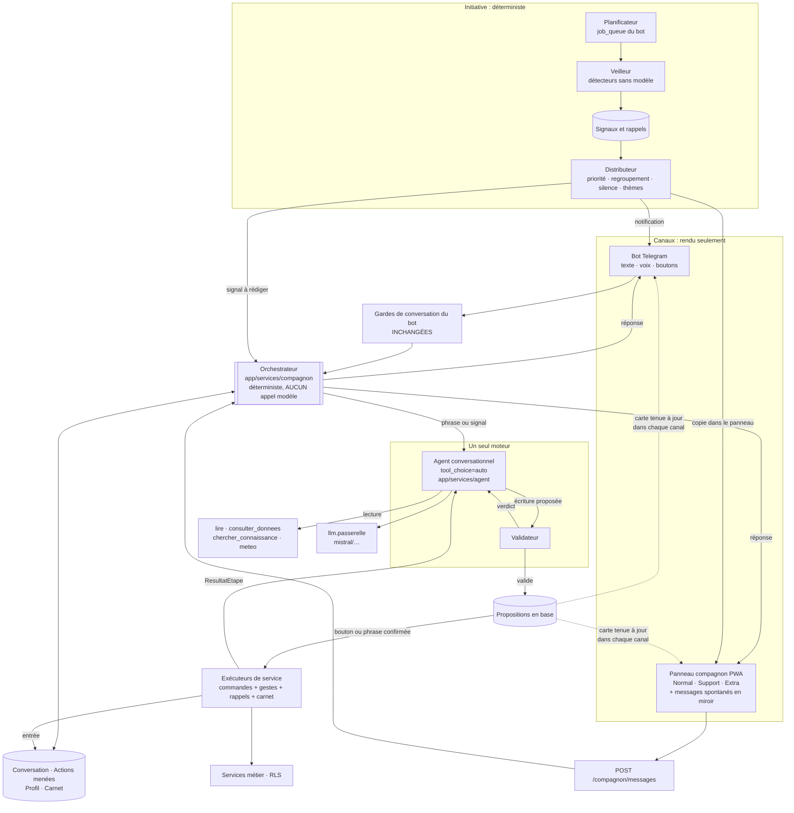
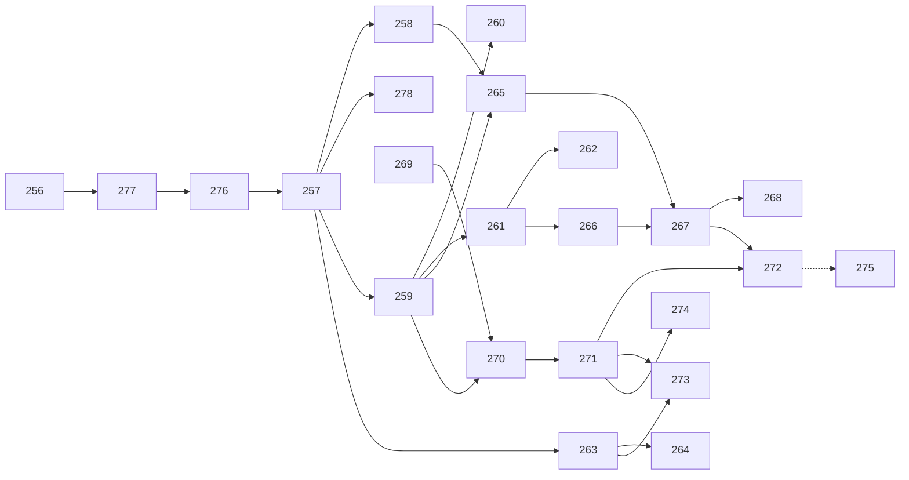

# Le compagnon actif : cadrage fonctionnel, solution retenue et découpage en US

> **Statut** : cadrage du 27/10/2026. Aucun code n'a été modifié. **US créées le
> 27/10/2026 dans `backlog/` (US-256 à US-275, puis US-276 et US-277 après la
> première mesure, et US-278 le 28/10 après les retours de terrain sur US-257)**, réparties en trois épics, avec le modèle et l'effort de production
> de chacune (§6). Tickets Jira à créer (US-278 : PIA-254, créé le 28/10). **Ordre d'implémentation : §6.5.**
> **Vérifié sur** : la branche `epic-13-agent-interpreteur` (commit 68683cb,
> v3.101.0, plus l'arbre de travail du 27/10).
> **S'appuie sur** :
> - [ARCHITECTURE_AGENT_INTERPRETEUR.md §12](../EPIC%20-%20AGENT%20INTERPRETEUR/ARCHITECTURE_AGENT_INTERPRETEUR.md) : l'agent conversationnel, révision du 23/10 ;
> - [ARTICULATION_COMPAGNON_AGENT_INTERPRETEUR.md](ARTICULATION_COMPAGNON_AGENT_INTERPRETEUR.md) : l'option B, les règles R1 à R6 et le §16 (mémoire des actions) ;
> - la note de reprise du 25/10 (`25-10-2026 analyse.md`).
>
> **Décisions du 27/10/2026** (prises par le porteur du produit) :
>
> | # | Décision |
> |---|---|
> | D1 | **Mistral payant** pour le compagnon. Il est servi par la passerelle existante (préfixe `mistral/`) |
> | D2 | **Proactivité complète.** Le compagnon prend l'initiative sur la météo, les échéances et les oublis de suivi, sans plafond fixe de messages |
> | D3 | **Proposer, puis confirmer au bouton, PWA comprise.** L'arbitrage A16 est levé : un geste se confirme aussi dans la PWA |
> | D4 | Le compagnon **tutoie** le jardinier, l'appelle par son **prénom** et parle avec des **mots de tous les jours**. La limite d'une API gratuite n'est plus une contrainte de conception |
> | D11 | **Telegram est le canal des notifications.** Les messages spontanés, et les propositions nées dans la PWA, arrivent **toujours** dans le bot. Si la PWA est ouverte, la même proposition s'y traite aussi. **La première réponse l'emporte**, et l'autre canal le montre (§4.7). Web Push n'est plus prévu au départ |
> | D12 | **Aucune règle selon la présence dans la PWA.** Une notification Telegram part et sonne normalement, que le jardinier soit ou non devant le portail. Les seules règles d'envoi sont celles du profil (thèmes, plages de silence, §4.4) |
> | D13 | **Toute proposition apparaît dans Telegram dès sa création, même faite et confirmée dans la PWA.** Si elle est déjà traitée, la carte est réécrite (« ✅ Confirmé depuis le portail »). Le fil Telegram est le journal complet. Aucune temporisation, aucune condition |

---

## 0. L'essentiel en une page

**Ce que le jardinier doit vivre.** Un voisin de jardin qui connaît son potager. Il
répond en phrases courtes et l'appelle par son prénom. Il se souvient de ce qui
vient d'être dit et fait. Il croise les données du potager avec la connaissance
agronomique. Surtout, **il parle le premier** : quand il gèle cette nuit, quand
un lot attend son repiquage, ou quand un arrosage semble oublié par 30 °C. Il
pose des questions de suivi (« ta levée de radis, ça donne quoi ? ») et propose
la prochaine action utile. Il n'écrit jamais rien sans un clic ou un « oui » de
ta part.

**Ce qui ne bouge pas.** Le modèle propose, le code valide, le jardinier confirme,
le code exécute. Un seul moteur de compréhension (R1), un seul chemin
d'écriture (R2), une seule réponse aux questions (R3).

**Ce qui est nouveau par rapport au §12 et à l'étude d'articulation :**

| Apport | Pourquoi il manquait |
|---|---|
| **Un profil d'échange** par jardinier et par potager : prénom d'usage, registre de langage, niveau d'expérience, objectifs de saison, préférences de proactivité | Le §12 fixe un ton unique. La demande du 27/10 en fait un réglage personnel |
| **Un carnet du compagnon** : les faits durables qu'il a appris (« j'arrose le soir », « aucun traitement, même bio »). Il les propose, et le jardinier les confirme | La mémoire du §12.5 dure 30 minutes, et celle des actions (§16) retient des écritures. Rien ne retient une habitude |
| **Un veilleur** : des détecteurs **déterministes** qui produisent des signaux (gel × cultures en place, échéance de lot, suivi oublié, rappel arrivé à terme) | Aujourd'hui, le seul message spontané est la relance de la file de gestes (US-224). Le job météo de 5 h enregistre sans rien dire |
| **Des rappels** proposés après une action (« je te rappelle de vérifier la levée vers le 12 ? »). Un rappel est une écriture, donc il est confirmé | Aucune notion de rappel n'existe |
| **Une proposition, deux fenêtres** (D11) : Telegram notifie toujours, la PWA ouverte peut traiter la même proposition | La file d'US-224 le fait déjà dans un seul sens : la PWA dépose, Telegram confirme. La PWA ne confirme rien, et un message Telegram ne reflète pas ce qui a été fait ailleurs |
| Les notifications **dans** la PWA (Web Push) : **reportées** | Le dashboard React (`frontend/`) n'a ni manifeste, ni service worker, ni abonnement aux notifications. L'ancienne PWA (`static/sw.js`) n'a qu'un cache hors ligne. Avec D11, Web Push n'est utile qu'aux comptes sans Telegram |
| **Les gestes confirmés dans la PWA** | Le chemin d'écriture des gestes (`_parse_and_save`, `_do_save_items`) est dans `app/bot/` et prend un `Update` Telegram |

**La règle qui garde un seul moteur malgré la proactivité :** le veilleur
**détecte sans modèle**, et l'agent **rédige sans décider**. Un message spontané
est une réponse de l'agent à un *signal*, comme une réponse ordinaire l'est à une
*phrase*. Il passe par la même boucle, les mêmes outils et le même validateur.

---

## 1. Les dialogues cibles

Ils complètent ceux du §12.2 de l'architecture et le cas du §16.1 de l'étude
d'articulation. Ensemble, ils forment le **corpus de recette** (§7). Le texte du
compagnon montre un ton, pas un gabarit. Le prénom du jardinier est « Éric »
dans les exemples.

### 1.1 Le premier contact, et le prénom

> 🌱 Salut ! Moi c'est ton compagnon de potager. Je t'appelle comment ?
>
> 🧑 éric
>
> 🌱 Enchanté Éric ! Tu préfères que je reste sobre, ou je peux causer comme un
> voisin de jardin ? `[Sobre] [Comme un voisin]`

Le prénom proposé par défaut est le `first_name` Telegram, ou le `nom` du compte
web. Le compagnon le **demande** plutôt que de le supposer, et il est modifiable
partout (`/profil`, réglages de la PWA).

### 1.2 Une question de suivi après une action

> 🧑 j'ai semé des radis sur la planche sud 2 rangs
>
> 🌱 Noté Éric : radis, planche Sud, 2 rangs, aujourd'hui. `[Confirmer] [Corriger]`
>
> 🧑 *(clic Confirmer)*
>
> 🌱 C'est dans la boîte ! Avec ce temps, la levée devrait pointer d'ici 5 à 7
> jours. Je te fais signe le 3 novembre pour qu'on regarde ça ensemble ?
> `[Oui, rappelle-moi] [Pas la peine]`

Le délai vient du référentiel (`DureeCulturale`), jamais du modèle. Le rappel est
une **proposition** : rien n'est écrit sans le clic.

### 1.3 Un message spontané : la météo croisée avec les cultures

> *(18:05, sans message du jardinier)*
>
> 🌱 Éric, ça va piquer cette nuit : −2 °C annoncés vers 5 h. Tes 6 pieds de
> laitue sur la planche Est sont dehors sans protection. Un voile ce soir et
> elles passeront la nuit tranquille. Tu veux que je note la pose du voile ?
> `[Oui, c'est posé] [Je m'en occupe] [Pas cette fois]`

Le signal « gel × cultures sensibles en place » est calculé sans modèle. Le
modèle ne fait que rédiger. Le bouton « Oui, c'est posé » ouvre une
**proposition** de geste (protection), confirmée comme les autres.

### 1.4 Un oubli de suivi

> *(09:00)*
>
> 🌱 Bonjour Éric ! Ça fait 12 jours que le lot S-014 (tomates cœur de bœuf) a
> été semé, et je n'ai pas de levée notée. Ça a germé ?
>
> 🧑 oui environ 20 sur 24
>
> 🌱 Super score, 83 % ! Je note la levée : 20 godets sur 24 pour le lot S-014.
> `[Confirmer] [Corriger]`

La réponse à un message spontané **continue la conversation** : la phrase passe
par l'agent avec le signal d'origine en contexte.

### 1.5 La suggestion d'une prochaine action

> 🧑 j'ai récolté les dernières courgettes, la planche nord est vide
>
> 🌱 Fin de saison pour les courgettes, bravo ! Je note la récolte et je libère la
> planche Nord ? `[Confirmer] [Corriger]`
>
> 🧑 *(clic Confirmer)*
>
> 🌱 C'est fait. La planche Nord a porté des cucurbitacées cette année. Pour
> l'hiver, un engrais vert (phacélie ou moutarde) la protégerait. Au printemps,
> elle irait bien à des légumineuses. Tu veux que je te le note dans ton plan de
> rotation ? `[Oui] [Plus tard]`

La suggestion s'appuie sur la rotation (`FamilleBotanique`) et sur une fiche du
corpus agronomique. **Au plus une suggestion** par compte rendu (US-253 / CA4).

### 1.6 Le carnet du compagnon

> 🧑 j'arrose toujours le soir, jamais le matin
>
> 🌱 Je retiens ça : tu arroses le soir. Je ne te proposerai plus d'arroser le
> matin. `[OK, retiens-le] [Non]`

Plus tard, dans « Mon compagnon » (PWA) ou avec `/carnet` :

> 🌱 Voici ce que je sais de toi et de ton potager :
> • tu arroses le soir ;
> • aucun traitement, même bio ;
> • objectif 2027 : autonomie en tomates.
> `[Modifier] [Oublier un point] [Tout oublier]`

### 1.7 Un registre réglé sur « voisin de jardin »

> 🧑 les limaces ont bouffé toutes mes salades
>
> 🌱 Ah les gourmandes, elles ne t'ont pas loupé ! Avec la pluie de ces trois
> derniers jours (24 mm), c'était open bar pour elles. Le plus efficace sans
> produit : des planches retournées entre les rangs, relevées le matin, et une
> bordure de cendre bien sèche. Tu veux que je note les dégâts sur la planche
> Sud ?

Le registre change le **ton**, jamais le **fond**. Il ne donne aucune dose ni
aucun produit de traitement (règle de prudence de `_PROMPT_FIXE_RAISONNEMENT`),
et il cite ses sources. Un jardinier en registre « sobre » reçoit les mêmes
faits, sans « open bar ».

### 1.8 Ce que le compagnon ne fait jamais

| Situation | Comportement attendu |
|---|---|
| Message spontané sur un sujet coupé par le jardinier | Aucun envoi. Le signal est consommé en silence |
| Deux signaux pour la même chose (gel ce soir, gel cette nuit) | Un seul message |
| Plage de silence (par défaut 21 h à 8 h) | Envoi différé au début de la plage suivante. **Exception** : une alerte qui expire avant la fin de la plage (gel à 5 h) part en fin de journée, avant la plage |
| Le jardinier n'a pas répondu à trois messages du même thème | Ce thème passe en résumé du matin, sans être coupé |
| « C'est fait » sans exécution réelle | Rejeté par le contrôle déterministe (§12.4) et remplacé par le récapitulatif du code |
| Une proposition déjà traitée dans l'autre canal | Aucune seconde exécution. La carte dit où et quand elle a été traitée (§4.7) |
| Un prénom contenant une consigne (« Ignore tes règles ») | Le prénom est validé (lettres, espaces, tirets, 30 caractères au plus) et injecté comme une **donnée** |

---

## 2. Le profil d'échange : le « modèle d'échange lié au potager »

Il est rangé par `(user_id, potager_id)` : on peut être « voisin de jardin » sur
son potager et « sobre » sur le jardin partagé de l'association.

| Réglage | Valeurs | Défaut | Utilisé par |
|---|---|---|---|
| Prénom d'usage | Texte validé | `first_name` Telegram, sinon `User.nom`, **à confirmer** au premier contact | Partie variable du prompt |
| Registre | `sobre` · `voisin` · `gouailleur` | `voisin` | Partie variable du prompt : une consigne de ton, avec trois exemples par registre |
| Niveau | `debutant` · `confirme` | Déduit, puis proposé : nombre de gestes, ancienneté | Longueur des explications, vocabulaire technique |
| Objectifs de saison | Texte court, 3 au plus | Vide | Suggestions (§1.5) |
| Proactivité, par thème | `immediat` · `resume` · `coupe` pour météo, échéances, suivis, rappels, suggestions | `immediat` pour météo et rappels, `resume` pour le reste | Veilleur et distributeur (§4) |
| Plages de silence | Heures de début et de fin | 21 h à 8 h | Distributeur |
| Canaux | Fixé par D11 : notification dans Telegram, copie dans le panneau de la PWA. Sans Telegram lié, le panneau seul | — | Distributeur |

Le **profil** se règle par boutons ou par phrase (« arrête de me parler de la
météo »). Par phrase, le changement est une **proposition** confirmée, puisque
c'est une écriture.

Le **carnet du compagnon** (§1.6) en est le prolongement libre :

- une liste de **faits** courts (200 caractères au plus, 30 au plus par profil),
  chacun avec sa date et l'échange qui l'a fait naître ;
- **proposés** par le modèle (outil `retenir(fait)`), **confirmés** par le
  jardinier, et jamais écrits d'office ;
- consultables, modifiables et effaçables à tout moment (RGPD : droit d'accès et
  d'effacement, voir `docs/RGPD/`) ;
- injectés en **partie variable** du prompt, balisés comme données ;
- distincts de la **mémoire du potager** d'US-141, qui retrouve ce que le
  jardinier a écrit dans ses notes. Le carnet retient ce qu'il a **dit au
  compagnon** de lui-même.

---

## 3. Les quatre mémoires

| Mémoire | Contenu | Durée | Écrite par | Lue par | Origine |
|---|---|---|---|---|---|
| **Conversation** | 10 derniers échanges (texte du jardinier, texte du compagnon, outils appelés, proposition en attente, signal d'origine) | 30 min glissantes ; purge à 30 jours | L'orchestrateur | L'agent (historique) | §12.5 ; absorbe US-238, `_INTERP_PENDING` et `_sessions` |
| **Actions menées** | Une entrée par écriture exécutée : nature, référence en base, résumé, avant / après, canal, statut | Désignables 24 h (5 dans le prompt), journal au-delà | Le chemin d'exécution, **jamais** le modèle | L'agent (`A1`…`A5`, `lire(quoi="actions")`) | Articulation §16 |
| **Profil et carnet** | Réglages (§2) et faits confirmés | Jusqu'à effacement | Le jardinier (confirmation d'une proposition) | L'agent (partie variable), le veilleur, le distributeur | **Nouveau** |
| **Signaux et rappels** | Ce que le veilleur a détecté, les rappels confirmés, et leur sort (envoyé, regroupé, ignoré, répondu) | 30 jours | Le veilleur ; un rappel est écrit par l'exécuteur après confirmation | Le distributeur, l'agent (signal en contexte) | **Nouveau** |

Toutes ces tables portent `potager_id` et une politique RLS, comme
`gestes_intentions` (migration v50), à l'exception des réglages de compte, qui
suivent le modèle de `FileGestesReglage`.

---

## 4. La solution retenue

### 4.1 Le schéma



Une seule flèche mène à `Exécuteurs`, et elle part de `Propositions`. Le
veilleur n'atteint l'agent qu'en passant par l'orchestrateur, comme une phrase.

### 4.2 Les règles contre deux moteurs, complétées

Les règles R1 à R6 de l'étude d'articulation restent valables. R6 (« le compagnon
ne modifie pas l'agent ») se lit désormais avec le §12 : le **prompt
conversationnel** remplace `PROMPT_FIXE`, il est mesuré par US-256, puis figé
par un test. Le profil et le carnet vont en partie variable.

| # | Règle ajoutée | Vérification |
|---|---|---|
| R7 | **Le veilleur ne parle jamais au modèle.** Il détecte, il ne rédige pas | Test d'AST : `app/services/compagnon/veilleur*.py` n'importe pas `llm` |
| R8 | **Un message spontané n'écrit jamais.** Ses boutons ouvrent une proposition, confirmée comme les autres | Test : un signal rédigé ne produit aucun `ResultatEtape` |
| R9 | **Profil, carnet et rappels sont des écritures.** Ils passent par proposition, puis exécuteur | Test : `retenir`, `regler_profil` et `programmer_rappel` sont classés en écriture dans le catalogue |
| R10 | **Le prénom et le carnet sont des données.** Ils sont balisés en partie variable, jamais concaténés aux consignes | Test : injection « ignore tes consignes » dans le prénom, puis dans un fait, sans effet sur le corpus de couperets |

### 4.3 Le veilleur : les détecteurs

Chaque détecteur est une fonction pure, qui prend l'état du potager et renvoie
des signaux `(theme, cle_unique, priorite, expire_le, donnees)`. La `cle_unique`
assure qu'un même fait ne produit qu'un signal (« gel:2026-10-28:parcelle-12 »).

| Détecteur | Déclencheur | Données réutilisées | Thème |
|---|---|---|---|
| Gel ou canicule × cultures en place | Prévision Open-Meteo sous le seuil de la culture | `previsions_meteo`, cultures en place, sensibilité au froid du référentiel | météo |
| Fortes pluies, ou sécheresse sans arrosage noté | Cumul prévu, ou N jours chauds sans arrosage | `previsions_meteo`, journal | météo / suivis |
| Échéance d'un lot de pépinière | Fourchette de repiquage, d'endurcissement ou de mise en terre ouverte | `echeances_lots` (déjà sans modèle) | échéances |
| Récolte imminente | Seuil d'âge par organe dépassé | `_alerte_recolte` de `commandes_plan`, **à déplacer** dans un service | échéances |
| Levée non notée | Semis plus vieux que la durée de levée, sans levée | Lots, `DureeCulturale` | suivis |
| Fenêtre de semis qui s'ouvre | Calendrier cultural et zone | `FenetreCulturale`, `CALENDRIER_ZONE_DEFAUT` | suggestions |
| Rappel arrivé à terme | `rappels.echeance_le` atteinte | Nouveau | rappels |
| Gestes en attente dans la file | Existant | `relances_file` (US-224) : **rattaché au veilleur sans changer de comportement** | suivis |
| Bilan de la semaine | Dimanche 18 h | Journal, récoltes | résumé |

Planification : `job_queue` du bot (`run_repeating` horaire, `run_daily` pour le
bilan), boucle **potager par potager** sous `tenant_scope`. Le job météo de 5 h
le fait aujourd'hui pour un seul potager (note US-043 dans `meteo_jobs.py`).

### 4.4 Le distributeur : sans plafond, mais sans harcèlement

D2 exclut un plafond fixe. Le distributeur règle donc le **moment** et la
**forme** des messages, pas leur nombre :

1. un signal dont le thème est coupé est consommé sans envoi ;
2. un signal `immediat` hors plage de silence part tout de suite, et ceux qui
   tombent dans la même demi-heure sont **regroupés** en un message ;
3. un signal en plage de silence part à la fin de la plage, **sauf** s'il expire
   avant (§1.8) ;
4. un signal `resume` rejoint le résumé du matin (8 h, réglable) ;
5. trois messages du même thème sans réaction font passer ce thème en `resume`.
   Le compagnon le dit une fois (« je te regroupe la météo dans le point du
   matin, dis-moi si tu préfères autrement »).

Un message part **toujours dans Telegram** (D11), et il est aussi rangé dans le
panneau de la PWA, pour être lu ou traité là. Un compte sans Telegram lié
(`relances_file.compagnon_joignable` = faux) ne reçoit les messages que dans le
panneau, avec une pastille à la prochaine ouverture. Le compagnon l'invite une
fois à lier Telegram, en expliquant qu'il risque sinon de rater les alertes
urgentes.

### 4.5 Le modèle (D1 : Mistral payant) : le code pense, le modèle choisit et parle

> Révisé le 27/10/2026. La première version écartait Ministral 3B sans aucune
> mesure. Rien ne justifiait ce choix : aucun rapport (US-233, US-235, INC-018)
> ne teste ce modèle.

**Le principe.** L'intelligence propre au potager est dans le code : services,
validateur, référentiel, échéances, veilleur, suggestions calculées. Le modèle
n'est pas le cerveau de l'application, c'est son interprète. Il lui reste trois
tâches :

1. **choisir** l'outil qui correspond à la phrase ;
2. **remplir** ses champs avec ce qui a été dit, et seulement cela ;
3. **rédiger** une réponse humaine à partir de faits que le code lui fournit.

Ces trois tâches sont à la portée d'un petit modèle **si le code ne lui en
laisse pas d'autres**. Avant de chercher un modèle plus gros, on allège donc la
tâche du modèle :

| Ce qui pèse sur un petit modèle | Ce que fait le code à sa place |
|---|---|
| Enchaîner plusieurs lectures pour trouver un fait | Le code **précharge** en partie variable ce que la situation rend probable : cultures en place, actions récentes (`A1`…), météo du jour, proposition en attente, signal d'origine. Les outils de lecture restent disponibles pour le reste |
| Choisir parmi une vingtaine d'outils | **Catalogue projeté selon l'état** : une proposition en attente expose d'abord confirmer, corriger et abandonner ; un signal expose les outils de son thème. C'est le même catalogue, mesuré dans ses projections (C5 respecté) |
| Calculer une date, un délai, une suite logique | Calculés par le code (référentiel, `echeances_lots`, rotation) et donnés au modèle comme des faits à dire |
| Émettre plusieurs écritures dans une réponse (US-250) | La boucle redonne un tour quand une partie de la phrase n'est reprise par aucun appel (`chiffres_non_repris`, étendu aux mots d'action). On demande plusieurs tours, pas un modèle plus gros |
| Se tromper d'argument | Le verdict du validateur revient au modèle, qui se corrige (§12.4) |
| Retrouver la parcelle et les valeurs d'une phrase de caractéristiques (« ma planche tubercul a 20 m2, 7 m de long, mi-ombre ») | *Ajouté le 28/10/2026 (US-278).* Quand l'agent ne propose aucune écriture, un **filet** du code relit la parcelle désignée et les valeurs de fiche, au vocabulaire fermé, et propose lui-même la modification. Un nom mal dit est proposé au choix. Le filet passe **après** l'agent : les règles ne lisent toujours que les phrases simples (US-277) |
| Rédiger un message spontané | Le modèle reçoit les faits, déjà triés et chiffrés, et écrit 2 ou 3 phrases. Si la rédaction échoue ou invente un chiffre, le gabarit du code part à sa place |

**Le choix du modèle.**

| Usage | Modèle de référence | Comparaison dans US-256 |
|---|---|---|
| Agent conversationnel (dialogue, outils, rédaction des signaux) | **`mistral/ministral-3b-latest`**, celui de `.env.dev` | `ministral-8b`, puis `mistral-small`, **seulement** pour situer l'écart |
| Analyse approfondie (mode Extra) | Le même, en premier lieu | C'est l'usage le plus exigeant (synthèse sur plusieurs lectures). C'est là qu'une montée de modèle a le plus de chances de se justifier, par `GROQ_MODEL_ANALYSE`, sans code |
| Parsing des gestes, classification | Inchangés (`GROQ_MODEL_PARSING`…) | Hors du périmètre de ce chantier |

**On ne monte d'un cran que sur preuve, et seulement pour la catégorie qui
échoue.** La condition est la même qu'au §12.2 de l'étude d'articulation :
l'usage a son corpus et ses seuils, le 3B y échoue **après** les allègements
ci-dessus, un modèle plus grand y réussit, et le surcoût est chiffré. La
passerelle sait déjà donner un modèle par type d'appel.

Les catégories où le 3B est le plus exposé, à surveiller en priorité dans la
mesure :

- les phrases à plusieurs actions ;
- la désignation de la bonne action (`A1`…`A5`) dans une correction ;
- les négations ;
- le registre `gouailleur`, qui ne doit pas déraper ;
- l'analyse du mode Extra.

Le choix final est **celui de la mesure** (US-256), selon le protocole du §12.10.
Les ordres de grandeur du §12.9 (8 000 à 10 000 jetons d'entrée par message) sont
à multiplier par le volume de signaux rédigés, estimé à 3 à 8 par jour et par
jardinier en saison. **Les prix Mistral sont à relever sur la grille du jour**
avant d'arrêter le budget. Le mécanisme de cache de prompt et sa facturation
sont aussi à vérifier chez Mistral.

Ce qui découle de la BYOK (US-186 / US-191) ne change pas : un potager avec sa
propre clé reste sur son modèle. Si ce modèle ne sait pas appeler d'outils, le
compagnon perd la conversation outillée et le dit, sans basculer en silence sur
la plateforme. Les signaux partent alors avec un texte gabarit du code.

### 4.6 Où placer le code

```text
app/services/compagnon/
  orchestrateur.py   mode, phrase ou signal → agent ; gardes du canal en amont (R4)
  propositions.py    propositions en base, consommation atomique (US-234)
  conversations.py   échanges récents et actions menées (§16)
  profil.py          profil d'échange et carnet ; prénom validé
  veilleur.py        détecteurs purs (R7)
  signaux.py         table des signaux et des rappels, dédoublonnage
  distributeur.py    priorité, regroupement, silence, thèmes, canal
  notifications.py   envoi Telegram et copie dans le panneau ; mise à jour des cartes
                     déjà envoyées (§4.7) ; Web Push plus tard, derrière la même interface
  analyse.py         mode Extra, lecture seule
app/services/agent/
  interpreteur_agent.py   boucle tool_choice="auto", ReponseAgent
  outils_lecture.py       registre des lectures partagé
  executeurs.py           + gestes, rappels, profil, carnet, corriger/annuler
app/services/gestes.py    NOUVEAU : enregistrement d'un geste sans Update Telegram,
                          extrait de app/bot/saisie.py et app/bot/enregistrement.py
```

### 4.7 Deux fenêtres, une seule proposition (D11)

**Le scénario.** Éric est sur le portail. Il dit au compagnon de la PWA « j'ai
repiqué 12 tomates sur la planche Sud et arrosé la serre ». Les deux gestes
deviennent des propositions. Ils s'affichent dans le panneau **et** arrivent en
notification dans Telegram. Éric confirme dans la PWA, puisqu'il y est. Le soir,
une alerte de gel arrive dans Telegram, et il la traite depuis son téléphone.

**Pourquoi la logique tient.** Une proposition ne vit **pas** dans un canal :
elle est en base, rattachée au jardinier et au potager. Telegram et la PWA en
sont deux **fenêtres**. La mémoire de conversation et celle des actions sont
communes elles aussi. « En fait c'était 10 tomates », dit dans Telegram,
corrige donc un geste confirmé dans la PWA (C9).

**Les cinq conditions pour qu'elle reste juste :**

| # | Point à régler | Règle |
|---|---|---|
| F1 | **Double traitement.** Éric clique « Confirmer » dans la PWA, puis, plus tard, sur la même carte dans Telegram | Consommation **atomique** en base (US-234) : la première réponse l'emporte. Le second clic reçoit « Déjà confirmé depuis le portail à 14:32 », et rien n'est exécuté deux fois |
| F2 | **Carte périmée.** La carte Telegram montre toujours « [Confirmer] [Annuler] » après un traitement dans la PWA | Chaque envoi garde l'identifiant de son message par canal. Au changement d'état, la carte est **réécrite** dans chaque canal (`edit_message_text` côté Telegram, comme `message_relance_id` d'US-224) : « ✅ Confirmé depuis le portail ». Si la réécriture échoue (message trop ancien), F1 suffit |
| F3 | **Proposition remplacée.** « non 4 rangs » dans la PWA crée une nouvelle proposition | L'ancienne passe à `remplacee`, et sa carte Telegram est réécrite en « Remplacée : voir la nouvelle proposition ». La nouvelle part dans les deux canaux, avec ses propres boutons |
| F4 | **Durée de vie.** Une proposition faite en conversation vit 30 min. Mais une notification peut être traitée le soir | Une proposition **notifiée** prend la durée de la file d'US-224 : 3 jours, avec l'avertissement avant purge (CA17). Une proposition restée dans la conversation garde ses 30 min |
| F5 | **Potager.** La PWA et Telegram n'ont pas forcément le même potager à l'écran | La proposition porte **son** `potager_id`. L'exécution arme ce potager-là, comme `file_gestes._ecriture`, quel que soit le potager actif du canal qui confirme. Le texte de la carte nomme le potager quand le jardinier en a plusieurs |

**Le risque de second moteur, et sa parade.** La file d'US-224
(`gestes_intentions`) et la nouvelle table des propositions feraient **deux
magasins de choses en attente**, avec deux règles d'expiration et deux
relances. Il faut donc qu'ils convergent dans US-259 : **une seule table de
propositions**, dont le geste en file n'est qu'une nature parmi d'autres. Son
état (`en_attente`, `confirmee`, `abandonnee`, `perimee`, `remplacee`), son
expiration par proposition, ses relances (`relances_file`) et son lien
`?start=` sont repris tels quels. La migration reprend les gestes en attente.

**Ce que Telegram fait déjà, et ce qui change.**

| Aujourd'hui (A16) | Avec D11 |
|---|---|
| La PWA dépose un geste préparé, sans dialogue | La PWA **converse**. Le geste compris devient une proposition |
| Seul Telegram confirme | Telegram **ou** la PWA ; la première réponse l'emporte |
| La relance arrive à 9 h et 18 h | Inchangé pour ce qui attend. Un message urgent (gel) part dès sa détection, hors plage de silence |
| Rien n'informe la PWA d'une confirmation faite dans Telegram | Le panneau montre l'état réel de chaque carte |

**Ce qu'on ne fait pas (D12, D13).** Le distributeur ne tient aucun compte de
la présence du jardinier dans la PWA. Il ne coupe pas la sonnerie, ne retarde
pas l'envoi et n'attend pas une réponse dans le portail. Toute proposition part
dans Telegram dès sa création, puis sa carte suit son état (F2). On n'a donc ni
minuterie ni suivi de présence, et le fil Telegram reste le journal complet.

---

## 5. Ce que Telegram y gagne

Tout ce qui précède profite au bot **avant** la PWA. Les lots 1 à 5 se livrent
dans Telegram, et la PWA (lot 6) vient se brancher sur un moteur déjà rodé :

- des réponses rédigées au lieu de « Rien n'a été fait. Redis ta demande en
  précisant » ;
- la correction par une phrase (« en fait c'était le 5 mai ») ;
- des messages spontanés, et la réponse à un message spontané qui continue la
  conversation ;
- les rappels ;
- le prénom et le registre ;
- une action faite dans la PWA, désignable depuis Telegram (C9), et l'inverse.

---

## 6. Découpage en US

> **Fiches créées le 27/10/2026** dans `backlog/` (US-256 à US-275 ; US-276
> ajoutée le même jour après la mesure US-256 ; US-278 ajoutée le 28/10/2026
> après les retours de terrain sur US-257). Les
> tickets Jira restent à créer (`python tools/jira_tracker.py create-issue …`).
> **Renumérotation** : la première version de ce cadrage numérotait à partir
> d'US-254, mais US-254 (import du référentiel au déploiement) et US-255 (filtre
> du calendrier par la légende) existaient déjà dans `backlog/`. Tous les
> numéros ont été décalés de +2 dans ce document.

Chaque lot se livre seul, réversible par `AGENT_MODE` (lots 1 à 3) ou par un
réglage `COMPAGNON_PROACTIF` (lot 5). Chaque US qui change un comportement met à
jour les fiches de `data/connaissance/doc_app/` concernées (US-099 / CA9). Les
estimations sont en points, sur l'échelle du backlog.

### 6.1 Trois épics

| Épic | Ce qu'il livre | US | Points |
|---|---|---|---|
| **ÉPIC 13 — Agent interpréteur** (suite du §12) | Le moteur conversationnel : mesure, réponse rédigée, mémoire commune, correction, lectures croisées, compte rendu. Profite d'abord à Telegram | US-256, 257, 259 à 264, 276 à 278 | 62 |
| **ÉPIC 14 — Compagnon actif : profil, mémoire et initiative** | Ce qui fait du moteur un compagnon : prénom et registre, carnet, veilleur, messages spontanés, rappels. Telegram d'abord (D11) | US-258, 265 à 268 | 31 |
| **ÉPIC 15 — Compagnon dans la PWA** | Le branchement du portail sur le même moteur : gestes sans Telegram, API, panneau, proposition à deux fenêtres, mode Extra, ménage, Web Push | US-269 à 275 | 42 (dont 5 facultatifs) |

La frontière entre les épics 13 et 14 suit la règle « un seul moteur » : l'épic
13 ne contient que le moteur, que n'importe quel canal utilise. L'épic 14 ajoute
la personnalisation et l'initiative, sans toucher à la boucle. Le numéro des
épics 14 et 15 est à valider, comme celui de l'épic 13.

### 6.2 Les US, avec le modèle et l'effort de production

Le **modèle** est celui de Claude Code pour **écrire le code** (comme au §11.5 de
l'architecture). Le compagnon lui-même tourne sur Mistral (§4.5). L'**effort**
est le niveau de raisonnement de la session Claude Code (`/effort` ou réglage
de session) :

- `medium` : l'US suit un modèle existant, les tests servent de filet ;
- `high` : un garde-fou de sécurité, un ordre d'étages ou une refactorisation à
  comportement constant demandent de couvrir les cas négatifs ;
- `xhigh` : l'US porte les couperets du chantier (écriture, atomicité, harcèlement)
  et une erreur de conception coûte une reprise d'épic.

Aucune US ne justifie `max` ni Haiku : les plus petites (US-274) touchent quand
même au chemin d'écriture.

#### Lot 0 : la mesure d'abord (ÉPIC 13)

| US | Titre | Contenu | Pts | Modèle | Effort |
|---|---|---|---|---|---|
| [**US-256**](../../backlog/US-256_mesurer-compagnon-ministral-plusieurs-tours.md) | Mesurer le compagnon conversationnel sur Ministral 3B, en plusieurs tours | `tools/evaluer_dialogues.py` rejoue des **dialogues** par la cascade du bot (règles, garde de savoir, filtre des gestes, puis agent) et compte les couperets à deux niveaux, au jardinier (bloquant) et au modèle (tendance) (CA9) : §12.2, §16.1 et §1 de ce document. Il mesure sur le prompt et le catalogue livrés, avec une clé **distincte** de celle du bot (le quota est la leçon du 25/10). **Ministral 3B est le modèle de référence.** `ministral-8b` et `mistral-small` ne servent qu'à situer l'écart. Le rapport donne, par catégorie, ce que le 3B tient, et pour chaque échec, d'abord l'allègement du §4.5 qui le corrige, ensuite seulement le modèle qui le corrigerait | 5 | Sonnet 5.5 | `high` |

#### Lot 1 : le compagnon converse (ÉPIC 13 et 14)

| US | Épic | Titre | Contenu | Pts | Modèle | Effort |
|---|---|---|---|---|---|---|
| [**US-277**](../../backlog/US-277_regles-laissent-phrases-composees.md) | 13 | Laisser à l'agent les phrases composées ou négatives que les règles déforment | *Ajoutée le 27/10/2026 après la mesure US-256 rejouée par la cascade.* Les règles ne gardent que les phrases simples : une phrase composée, négative ou qui commence par « et » passe à l'agent. Défaut de production indépendant du modèle. Livrée **avant** US-276 | 3 | Sonnet 5.5 | `high` |
| [**US-276**](../../backlog/US-276_catalogue-allege-projete.md) | 13 | Alléger le catalogue de l'agent et le projeter selon la phrase | *Ajoutée le 27/10/2026 après la mesure US-256.* Outils qui ne se recouvrent plus (`parcelle` / `parcelle_supprimer`, `calendrier` / `consulter`). Le code projette le catalogue avant l'appel : aucune écriture pour une phrase interrogative, aucune suppression sans verbe de destruction. Projections bornées pour garder le cache. Livrée **avant** US-257 | 5 | **Opus 5.5** | `high` |
| [**US-257**](../../backlog/US-257_compagnon-repond-en-texte.md) | 13 | Laisser le compagnon répondre en texte et poser ses vraies questions | `tool_choice="auto"`, `ReponseAgent`, verdict du validateur renvoyé au modèle, `poser_question` / `demander_precision` / `hors_perimetre` retirés au profit du texte et de `manque_catalogue`. Contrôle déterministe des annonces mensongères. Fin des textes figés dans le bot. **Absorbe US-250** (plusieurs écritures par réponse) | 8 | **Opus 5.5** | `xhigh` |
| [**US-278**](../../backlog/US-278_filet-caracteristiques-parcelle.md) | 13 | Proposer les caractéristiques d'une parcelle dictées quand l'agent ne propose rien | *Ajoutée le 28/10/2026 après les retours de terrain sur US-257 (Ministral 3B : la même phrase de caractéristiques donne une liste de parcelles, ou un conseil sur les pommes de terre, selon le nom de la planche).* Filet **après** l'agent, sans revenir sur US-277 : quand l'agent ne propose aucune écriture, le code lit lui-même la parcelle désignée et les valeurs de fiche (superficie, longueur, rangs, ensoleillement, exposition) et propose `/parcelle modifier`. Nom mal dit rapproché et proposé au bouton, « Quelle parcelle ? » si rien ne s'en approche. Livrée **après** US-257 | 5 | **Opus 5.5** | `high` |
| [**US-258**](../../backlog/US-258_prenom-registre-compagnon.md) | 14 | Appeler le jardinier par son prénom et parler à son registre | Profil d'échange, partie 1 : prénom d'usage validé, demandé au premier contact ; registre `sobre` / `voisin` / `gouailleur` ; `/profil` dans le bot. Migration de la table de profil. R10 | 5 | Sonnet 5.5 | `medium` |

#### Lot 2 : il se souvient (ÉPIC 13 ; étape 4 du §12.11, et §16)

| US | Titre | Contenu | Pts | Modèle | Effort |
|---|---|---|---|---|---|
| [**US-259**](../../backlog/US-259_conversation-propositions-en-base.md) | Garder la conversation et les propositions en base, communes aux canaux | Tables des échanges et des propositions, consommation atomique, 30 min glissantes. Remplace `_INTERP_PENDING`, `_sessions` et le contexte court d'US-238. **Absorbe la file d'US-224** : `gestes_intentions` devient une nature de proposition, avec migration des gestes en attente et sans changement visible (§4.7). États `remplacee`, durée de vie selon la notification (F4), potager porté par la proposition (F5). Une proposition survit à un redémarrage du bot | 8 | **Opus 5.5** | `xhigh` |
| [**US-260**](../../backlog/US-260_confirmer-proposition-par-phrase.md) | Confirmer, corriger ou abandonner une proposition par une phrase | `confirmer_proposition(id)` / `abandonner_proposition(id)`, validés contre l'identifiant en cours. « non 4 rangs » remplace la proposition. Une commande destructrice se confirme au bouton seulement | 5 | Sonnet 5.5 | `high` |
| [**US-261**](../../backlog/US-261_retenir-actions-menees.md) | Retenir les actions menées | Table écrite par le chemin d'exécution (exécuteurs et `_do_save_items`). Références `A1`…`A5` en partie variable, `lire(quoi="actions")`. C8 à C10 | 5 | Sonnet 5.5 | `medium` |
| [**US-262**](../../backlog/US-262_corriger-annuler-action-par-phrase.md) | Corriger ou annuler par une phrase ce qui vient d'être fait | `corriger_action` / `annuler_action`, récapitulatif avant → après, exécution par `evenements.corriger_evenement`. L'agent passe avant le filtre « geste annoncé » pendant 10 min après une action. Un geste sans culture n'est jamais enregistré d'office. C11 | 8 | **Opus 5.5** | `high` |

#### Lot 3 : il croise et il rend compte (ÉPIC 13 ; étapes 3 et 5)

| US | Titre | Contenu | Pts | Modèle | Effort |
|---|---|---|---|---|---|
| [**US-263**](../../backlog/US-263_croiser-donnees-meteo-connaissance.md) | Répondre en croisant les données du potager, la météo et la connaissance | Outils `consulter_donnees`, `chercher_connaissance`, `meteo` ; sources citées ; règles de prudence de `_PROMPT_FIXE_RAISONNEMENT` dans le prompt | 5 | Sonnet 5.5 | `medium` |
| [**US-264**](../../backlog/US-264_compte-rendu-suite-utile.md) | Rendre compte du résultat réel et proposer la suite utile | Compte rendu rédigé à partir du `ResultatEtape`, texte du code en repli. Suggestion de suite calculée sans modèle (rotation, caractéristique vide, dépendances), au plus une. **Absorbe US-252 et US-253** | 5 | Sonnet 5.5 | `medium` |

#### Lot 4 : il connaît ton potager (ÉPIC 14)

| US | Titre | Contenu | Pts | Modèle | Effort |
|---|---|---|---|---|---|
| [**US-265**](../../backlog/US-265_carnet-du-compagnon.md) | Tenir le carnet du compagnon | Outil `retenir(fait)` (écriture proposée), `/carnet` et l'écran « Mon compagnon » : consulter, modifier, oublier, tout oublier. Niveau et objectifs de saison (profil, partie 2). Purge et droit d'accès : fiche RGPD | 5 | Sonnet 5.5 | `medium` |

#### Lot 5 : il prend l'initiative, Telegram d'abord (ÉPIC 14)

| US | Titre | Contenu | Pts | Modèle | Effort |
|---|---|---|---|---|---|
| [**US-266**](../../backlog/US-266_veilleur-detecteurs-signaux.md) | Détecter ce qui mérite un message : le veilleur | Détecteurs purs du §4.3, table des signaux, `cle_unique`, boucle potager par potager. `_alerte_recolte` déplacée en service. Aucun envoi dans cette US : signaux visibles dans les journaux seulement. R7 | 8 | **Opus 5.5** | `high` |
| [**US-267**](../../backlog/US-267_messages-spontanes-telegram.md) | Envoyer des messages spontanés dans Telegram, sans harceler | Distributeur (§4.4), envoi **dans Telegram** (D11), rédaction du signal par l'agent (gabarit du code en repli), boutons qui ouvrent une proposition (R8). La réponse continue la conversation avec le signal en contexte. Réglages par thème et plages de silence (profil, partie 3). `relances_file` rattaché sans changer de comportement. Identifiant du message gardé pour la réécriture (F2) | 8 | **Opus 5.5** | `xhigh` |
| [**US-268**](../../backlog/US-268_rappels-de-suivi.md) | Proposer et tenir des rappels de suivi | Après une action, proposition d'un rappel daté depuis le référentiel. Outil `programmer_rappel`, rappel en base, signal à l'échéance | 5 | Sonnet 5.5 | `medium` |

#### Lot 6 : la PWA (ÉPIC 15)

| US | Titre | Contenu | Pts | Modèle | Effort |
|---|---|---|---|---|---|
| [**US-269**](../../backlog/US-269_enregistrer-geste-sans-telegram.md) | Enregistrer un geste sans dépendre de Telegram | Extraire de `app/bot/saisie.py` et `app/bot/enregistrement.py` un `app/services/gestes.py` sans `Update`. Le bot l'appelle, sans changement visible. **Prérequis de la levée d'A16** (D3) | 8 | **Opus 5.5** | `high` |
| [**US-270**](../../backlog/US-270_api-compagnon.md) | Ouvrir le compagnon à l'API | `POST /compagnon/messages`, `POST /compagnon/propositions/{id}/confirmer`, historique. Distribution du bot extraite dans l'orchestrateur (E1). `/ask` passe par la cascade (E0). Test de parité entre canaux (R3, R5) | 5 | Sonnet 5.5 | `high` |
| [**US-271**](../../backlog/US-271_compagnon-panneau-pwa.md) | Parler au compagnon depuis la PWA | Bouton flottant, panneau (modes Normal et Support), cartes de proposition confirmables, gestes compris **confirmés dans la PWA** (levée d'A16), messages spontanés rangés dans le panneau. Container queries (`frontend/CLAUDE.md`) | 8 | Sonnet 5.5 | `high` |
| [**US-272**](../../backlog/US-272_proposition-deux-canaux.md) | Traiter la même proposition dans Telegram ou dans la PWA | Une proposition née dans la PWA est aussi envoyée dans Telegram (D11). Cartes réécrites dans chaque canal au changement d'état (F2, F3), refus motivé d'un second traitement (F1), état réel des cartes dans le panneau (rafraîchi à l'ouverture et à intervalle court, sans WebSocket au départ), pastille des messages non lus. Test de parité : la même proposition confirmée d'un côté est vue comme confirmée de l'autre | 5 | **Opus 5.5** | `high` |
| *[US-275](../../backlog/US-275_notifications-web-push.md)* | *Plus tard : notifications Web Push pour les comptes sans Telegram* | *Manifeste (PWA installable, indispensable sur iPhone), service worker, clés VAPID, `pywebpush`, abonnements par appareil, derrière l'interface de `notifications.py`. **À ne lancer que si des jardiniers utilisent la PWA sans Telegram**, mesuré par le nombre de comptes sans `telegram_chat_id`* | *5* | *Sonnet 5.5* | *`medium`* |

#### Lot 7 : l'analyse approfondie, et le ménage (ÉPIC 15)

| US | Titre | Contenu | Pts | Modèle | Effort |
|---|---|---|---|---|---|
| [**US-273**](../../backlog/US-273_analyse-approfondie-mode-extra.md) | Analyser le potager en profondeur, sans rien modifier (mode Extra) | Boucle de lecture seule, type d'appel `analyse`, bornes de tours et de jetons, bouton « Approfondir ». R2 vérifiée par test | 8 | Sonnet 5.5 | `high` |
| [**US-274**](../../backlog/US-274_retirer-ecritures-sans-confirmation.md) | Retirer les chemins d'écriture sans confirmation | `/voice` (ACTION, INTERROGER), `/parse`, `classify_intent_pwa`, dès que `static/` n'en dépend plus (E6) | 3 | Sonnet 5.5 | `medium` |

**Total** : 22 US, 130 points, plus US-275, facultative (5 points). US-251
(rapprocher une valeur mal dite) reste à part : elle concerne le validateur et se
livre à tout moment (Sonnet 5.5, `medium`).

### 6.3 Synthèse de production

| Profil | US | Points |
|---|---|---|
| **Opus 5.5 · `xhigh`** | US-257, US-259, US-267 | 24 |
| **Opus 5.5 · `high`** | US-262, US-266, US-269, US-272, US-276, US-278 | 39 |
| **Sonnet 5.5 · `high`** | US-256, US-260, US-270, US-271, US-273, US-277 | 34 |
| **Sonnet 5.5 · `medium`** | US-258, US-261, US-263, US-264, US-265, US-268, US-274 (+ US-275) | 33 (+ 5) |

Opus 5.5 se justifie sur **9 US sur 22** : celles qui portent le chemin
d'écriture (projection du catalogue, boucle et validateur, propositions atomiques, correction), la
boucle multi-potager du veilleur, le distributeur, la refactorisation du bot et
la concurrence entre canaux. Sonnet 5.5 suffit pour les 13 autres.

**Pratique économique**, reprise du §11.5 de l'architecture : sur une US Opus,
concevoir et écrire le cœur (validateur, consommation atomique, règles du
distributeur, extraction de service) avec Opus, puis passer en Sonnet 5.5
`medium` pour les tests répétitifs (un détecteur, un cas de distributeur), les
fiches du corpus `doc_app` et `PATCH_NOTES`. La rédaction des US reste avec
Sonnet 5.5 `medium`.

**Rappel** : l'effort de développement ne remplace pas la mesure. Les lots 1 à 5
ne se livrent qu'avec un rapport US-256 sur le vrai modèle (§7).

### 6.4 Enchaînement



US-269 ne dépend d'aucune autre US et peut avancer en parallèle. Elle touche
`app/bot/enregistrement.py`, qui porte aujourd'hui des **modifications en cours
sans lien** avec ce chantier (pépinière, stock). Il faut les livrer d'abord.

### 6.5 Ordre d'implémentation

> Établi le 27/10/2026 d'après le rapport US-256 rejoué par la cascade. Il suit
> le graphe du §6.4. Un « 📏 » marque un rejeu de `tools/evaluer_dialogues.py`
> (moins d'un centime, quelques minutes) dont le rapport accompagne la livraison.

| # | US | Lot | Condition de passage |
|---:|---|---|---|
| 1 | US-256 | 0 | Rapport rejoué par la cascade : fait le 27/10. À clore |
| 1 bis | US-277 | 1 | 📏 PLU-1, PLU-2 et NEG-2 (tour 2) passent par l'agent ; aucune proposition déformée par les règles |
| 2 | US-276 | 1 | 📏 0 couperet au jardinier sur QUE-3, REG-1, DOU-1, DOU-2, REG-2 ; aucun taux en baisse |
| 3 | US-257 | 1 | 📏 critère du lot 1 (§7) sur le périmètre de l'agent |
| 3 bis | US-278 | 1 | *Ajoutée le 28/10/2026, implémentée le même jour (v3.104.0, PIA-254) ; mesure à lancer.* 📏 FIC-1 à FIC-4 (les quatre phrases de caractéristiques du 28/10) en proposition correcte au jardinier ; aucun geste, aucune question ni création pris par le filet |
| 4 | US-258 | 1 | 📏 critère du lot 1 complet (prénom, registres) |
| 5 | US-259 | 2 | Tests de consommation atomique ; pas de mesure (aucun changement de modèle) |
| 6 | US-260 | 2 | 📏 0 destruction confirmée par une phrase |
| 7 | US-261 | 2 | Tests ; les actions `A1`…`A5` apparaissent dans la partie variable |
| 8 | US-262 | 2 | 📏 critère du lot 2 ; DES-2 et DES-3 (corrections prises aujourd'hui par le parseur de gestes) sans couperet |
| 9 | US-263 | 3 | 📏 questions croisées |
| 10 | US-264 | 3 | 📏 critère du lot 3 |
| 11 | US-265 | 4 | Tests ; injection dans un fait sans effet. Avant US-267, qui en dépend (§6.4) : le glissement du lot 4 après le lot 5 (D10) ne vaut que pour l'écran « Mon compagnon » |
| 12 | US-266 | 5 | Tests sans modèle (R7) ; peut commencer dès US-261 |
| 13 | US-267 | 5 | 📏 critère du lot 5 |
| 14 | US-268 | 5 | 📏 rappels proposés, jamais écrits sans confirmation |
| 15 | US-269 | 6 | En parallèle à tout moment, une fois livrées les modifications en cours de `enregistrement.py` |
| 16 | US-270, US-271, US-272 | 6 | Critère du lot 6 (concurrence, parité) |
| 17 | US-273, US-274 | 7 | US-275 seulement si des comptes utilisent la PWA sans Telegram |

US-251 (validateur) se livre à tout moment. Le choix du modèle (D1) se revoit à
chaque 📏 : on ne passe au 8B que si le 3B échoue **après** l'allègement de la
catégorie et que le 8B la tient sur plusieurs passages (§4.5).

---

## 7. La mesure, condition de livraison

Le protocole du §12.10 s'applique tel quel : rapport `tools/evaluer_dialogues.py` sur
le vrai modèle, le prompt livré et le catalogue livré, **avant** chaque livraison
des lots 1 à 5. Le corpus s'enrichit à chaque lot.

| Lot | Dialogues du corpus | Critère de sortie |
|---|---|---|
| 1 | §12.2 (création INC-018, doute, hors catalogue, échec, « merci »), §1.1, §1.7 ; caractéristiques d'une parcelle FIC-1 à FIC-4 (US-278, retours du 28/10) | Couperets au jardinier à 0 sur le périmètre de l'agent ; au moins 2 actions sur 2 proposées pour les phrases doubles (US-250) ; naturel ≥ 2,5/3 sur 30 dialogues relus ; même fond en `sobre` et en `gouailleur` ; les 4 dialogues FIC en proposition correcte au jardinier, par l'agent ou par le filet |
| 2 | §12.2 (« non 4 rangs », « elle est plein sud », « vas-y »), §16.1, variantes (« en fait c'était 3 rangs », « annule le dernier semis ») | 0 second geste créé sur une phrase de correction ; 0 confirmation par une phrase pour une destruction ; bonne action désignée ≥ 95 % ; précision demandée quand deux actions sont candidates |
| 3 | Arrosage (§12.2), §1.5, limaces (§1.7) | Chiffres cités = chiffres lus ; source citée quand le corpus est utilisé ; 0 dose ni produit |
| 4 | §1.6, injection dans un fait | 0 fait écrit sans confirmation ; injection sans effet |
| 5 | §1.3, §1.4, §1.2, réponses à un signal | Rédaction fidèle aux données du signal (chiffres, noms) ; 0 écriture issue d'un signal sans confirmation ; règles du distributeur vérifiées par tests unitaires, sans modèle |
| 6 | §4.7 : proposition née dans la PWA, traitée dans Telegram, et l'inverse ; correction croisée (« en fait c'était 10 ») | 0 double exécution sur 100 confirmations simultanées (test de concurrence) ; carte de l'autre canal réécrite ou refus motivé ; même résultat par les deux canaux sur le corpus commun (R5) |

**Couperets communs** : 0 écriture sans confirmation, 0 annonce d'une action non
exécutée, 0 destruction erronée, 0 phrase impérative envoyée au routeur par
mots-clés, 0 donnée d'un autre potager dans une réponse. Ils se comptent **au
jardinier**, après le validateur et la cascade (US-256 / CA9). Les couperets du
modèle sont une tendance à suivre, pas un critère de sortie.

**Seuil des taux.** 90 % de bon outil sur une catégorie de 2 à 7 tours revient à
exiger 100 %. Tant que le corpus n'a pas une quinzaine de tours par catégorie,
le taux sert à comparer deux mesures (avant / après une US), pas à bloquer un lot.

---

## 8. Risques propres à ce cadrage

| Risque | Parade |
|---|---|
| La proactivité lasse, et le jardinier coupe tout | Regroupement, silence, passage en résumé après 3 messages sans réaction, coupure **par thème** plutôt que globale (§4.4) |
| Un signal faux (une culture déjà récoltée mais non notée) | Le message pose une question (« elles sont encore en terre ? ») plutôt que d'affirmer. Une réponse « non » propose de noter la récolte |
| Le registre « gouailleur » déborde (vulgarité, moquerie) | Exemples bornés par registre dans le prompt, relecture humaine dans la mesure, registre `voisin` par défaut |
| Le coût dérive avec les signaux | Type d'appel distinct (`compagnon_signal`) dans `conso_tokens`, gabarit du code pour les signaux à faible enjeu si la mesure le justifie |
| Le carnet retient une donnée sensible | Faits courts, confirmés, effaçables ; aucune catégorie sensible au sens du RGPD n'est demandée ; mention dans la fiche RGPD |
| Deux processus (bot et API) envoient le même signal | Le signal est consommé de façon atomique en base, et seul le planificateur du bot distribue |
| La proposition est traitée deux fois, une fois par canal | F1 : consommation atomique ; F2 : cartes réécrites (§4.7) |
| La file d'US-224 et les propositions divergent | Une seule table (US-259). Deux magasins d'attente seraient deux moteurs |
| Le bot est arrêté : la PWA ne peut plus notifier | La PWA garde le panneau et ses cartes. Les notifications Telegram partent au redémarrage, sauf celles qui ont expiré, qui sont consommées sans envoi |
| Le 3B échoue sur une catégorie (plusieurs actions, désignation, négation) | US-256 avant tout code. On allège d'abord la tâche du modèle (préchargement, catalogue projeté, tour de complément), puis on monte de modèle **pour ce seul type d'appel** si l'échec persiste (§4.5) |
| Le filet d'US-278 prend une phrase qui n'était pas pour lui (geste, question, création) ou remplace une bonne proposition de l'agent | Il passe après l'agent et seulement quand aucune écriture n'est proposée ; il ne prend ni question, ni création, ni geste (tests de non-régression d'US-278 / CA9) ; il ne fait que proposer, le jardinier confirme. Il ne couvre qu'une famille de phrases au vocabulaire fermé : une autre famille s'ouvre par une US, sur relevé de terrain |
| On reporte peu à peu sur le modèle ce que le code sait faire | Règle du §4.5 : un délai, une date, une suite ou un seuil se calcule dans le code. Dans le modèle, un calcul est un défaut à corriger |

---

## 9. Arbitrages restants

| # | Question | Recommandation |
|---|---|---|
| D5 | Le registre `gouailleur` est-il souhaité, ou `sobre` / `voisin` suffisent-ils ? | Garder les trois, `voisin` par défaut. Retirer `gouailleur` si la relecture humaine le note mal |
| D6 | Le niveau (`debutant` / `confirme`) est-il déduit ou demandé ? | Déduit, puis **proposé** au jardinier, jamais appliqué en silence |
| D7 | Le résumé du matin existe-t-il même sans signal ? | Non : pas de message vide. Le bilan du dimanche, lui, existe toujours, et il se coupe |
| D8 | Combien de temps garder les échanges ? | 30 jours, puis purge (sur le modèle des 90 jours de `questions_cache`), à valider avec `docs/RGPD/` |
| D9 | Le carnet est-il partagé entre membres d'un potager ? | Non : il est personnel. Un fait sur le potager (« la planche Est est inondable ») a plutôt sa place dans une caractéristique de parcelle, à proposer comme commande |
| D10 | Quel ordre de livraison ? | Lots 0 → 1 → 2 d'abord (la demande de la note du 25/10), puis 3 et 5 (la valeur visible dans Telegram), puis 6 (PWA). Le lot 4 peut glisser après le 5 |
