# 03 — Enchaînement : série, parallèle, portes de mesure

## 1. Les dépendances

Elles viennent du champ « Dépendances » de chaque fiche du backlog. Une flèche pleine = « ne peut pas être livrée avant » ; une
flèche pointillée = « profite de » ou « se conçoit en parallèle ».

```mermaid
flowchart LR
    subgraph L0["Lot 0 — Mesurer (10 pts)"]
        U336["US-336<br/>Jeu d'évaluation<br/>5 · ✅"] --> U337["US-337<br/>Lanceur + ligne de base<br/>5 · 🟡 CA8"]
    end
    G0{{"Porte G0<br/>ligne de base<br/>chaîne actuelle"}}
    U337 --> G0

    subgraph L1["Lot 1 — Capacités (14 pts)"]
        U338["US-338<br/>Registre neutre<br/>5"] --> U339["US-339<br/>situation_culture<br/>3"]
        U338 --> U341["US-341<br/>Connaissance par culture<br/>3"]
        U339 --> U340["US-340<br/>que_faire_maintenant<br/>3"]
    end
    G0 --> U338
    G1{{"Porte G1<br/>mesure après lot 1"}}
    U339 --> G1
    U340 --> G1
    U341 --> G1

    subgraph L2["Lot 2 — Boucle et fil (13 pts, Opus)"]
        U343["US-343<br/>Fil complet<br/>5"] <--> U342["US-342<br/>Boucle + interrupteur PWA<br/>8"]
    end
    G1 --> U342
    G2{{"Porte G2<br/>le jeu passe<br/>sur la PWA de dev"}}
    U342 --> G2
    U343 --> G2

    subgraph L3["Lot 3 — Écritures (8 pts)"]
        U344["US-344<br/>Écritures + cartes<br/>5"] --> U345["US-345<br/>Corrections, rappels, carnet<br/>3"]
    end
    G2 --> U344
    G3{{"Porte G3<br/>parité d'écriture"}}
    U345 --> G3

    U346["US-346<br/>Telegram, voix, spontanés<br/>5 (lot 4)"]
    G3 --> U346
    G4{{"Porte G4<br/>deux canaux,<br/>un moteur"}}
    U346 --> G4
    U347["US-347<br/>Retrait de l'ancien moteur<br/>5 (lot 5)"]
    G4 --> U347

    subgraph SAV["Hors chemin critique — peuvent démarrer tout de suite"]
        U348["US-348 Fiches agronomiques · 8"]
        U349["US-349 Compléments du référentiel · 3"]
        U350["US-350 Passerelle top_p · 2"]
    end
    U348 -.rattachement.-> U341
    U349 -.profite à.-> U339
    U349 -.profite à.-> U340
    U350 -.comparer Large 3 / 4.-> U337
```

## 2. Ce qui se fait en série, ce qui se fait en parallèle

### En série (obligatoire)

| Enchaînement | Pourquoi |
|---|---|
| US-336 → US-337 | Le lanceur joue le jeu |
| US-337 (ligne de base) → tout lot ≥ 1 | **Un lot se mesure avant et après**, avec la chaîne actuelle comme témoin (§7.3) |
| US-338 → US-339, US-341 | Les capacités s'écrivent dans le registre neutre |
| US-339 → US-340 | `que_faire_maintenant` s'appuie sur le verdict de saison par culture |
| US-339, 340, 341 → US-342 | La boucle a besoin de capacités qui répondent aux besoins du jeu |
| US-342 + US-343 → US-344 | Une écriture se propose dans la boucle et se rattache au fil |
| US-344 → US-345 → US-346 | Les corrections, rappels et carnet reposent sur le chemin d'écriture ; Telegram et la voix passent ensuite |
| US-342 à US-346 → US-347 | On ne retire l'ancien moteur qu'une fois le nouveau mesuré partout |

### En parallèle (possible)

| Ensemble | Condition | Gain |
|---|---|---|
| **US-348, US-349, US-350** avec tout le reste | Aucune dépendance bloquante. US-348 se rattache ensuite à une culture (US-341) ; US-349 améliore les verdicts de US-339 et US-340 | 13 points hors chemin critique |
| **US-339 ∥ US-341** (après US-338) | Deux capacités indépendantes dans des fichiers distincts | Raccourcit le lot 1 |
| **US-343 (conception) ∥ lot 1** | Le schéma du fil (colonne `messages` ou table dédiée) et la compaction ne dépendent pas des capacités. **Livraison commune avec US-342** | Réduit l'attente avant le lot 2 ; à ne tenter que si le cadrage technique (colonne ou table) est tranché |
| **US-350 avant la mesure de comparaison** | Large 3 et Large 4 ne passent la passerelle qu'avec US-350 | Permet de mesurer la configuration B du 14/11 telle quelle |

### À ne pas paralléliser

| Ensemble | Pourquoi |
|---|---|
| US-342 et US-343 **livrées séparément** | La boucle sans fil perd l'intention ; le fil sans boucle ne sert à rien. Livraison ensemble ou US-343 juste après |
| US-344 et US-345 | Même chemin d'écriture : deux sessions modifieraient `gestes_conversation`, `propositions` et les cartes |
| Deux lots ≥ 1 en même temps | Chaque lot se mesure avant / après sur le même jeu ; mesurer deux changements à la fois les rendrait indiscernables |

## 3. Les vagues

| Vague | US | Points | Peut démarrer | Sortie |
|---|---|---|---|---|
| **V0** | US-337 (CA8), **US-350**, **US-348**, **US-349** | 2 + 8 + 3 (+ CA8) | Maintenant | Ligne de base de la chaîne actuelle (porte G0), passerelle corrigée, fiches et référentiel en cours |
| **V1** | **US-338** | 5 | Après G0 et commit des US-290 à 297 | Registre neutre, test de parité MCP vert |
| **V2** | **US-339 ∥ US-341**, puis **US-340** | 9 | Après V1 | Trois capacités ; mesure **G1** |
| **V3** | **US-342 + US-343** (Opus) | 13 | Après G1 | Le jeu passe sur la PWA de dev ; **G2** |
| **V4** | **US-344**, puis **US-345** | 8 | Après G2 | Parité d'écriture ; **G3** |
| **V5** | **US-346** | 5 | Après G3 | Deux canaux, un moteur ; **G4** |
| **V6** | **US-347** | 5 | Après G4 et arbitrages A1, A5, A7 | Ancien moteur retiré ; mesure finale **G5** |

**Chemin critique** : US-338 (5) → US-339 (3) → US-340 (3) → US-342/343 (13) → US-344 (5) → US-345 (3) → US-346 (5) →
US-347 (5) = **42 points** sur 68. Les 26 autres points (lot 0, US-341, US-348, US-349, US-350) se placent autour sans le
rallonger.

## 4. Les portes (points d'arrêt)

Une porte n'est pas une livraison : c'est une **décision**, prise sur une mesure du jeu d'évaluation, avec la chaîne actuelle comme
témoin et **un accord sur le volume** avant tout appel au vrai modèle.

| Porte | Après | Question posée | Condition de passage | Si ça échoue |
|---|---|---|---|---|
| **G0** | US-337 | Quel est le point de départ ? | Ligne de base mesurée (CA8) et versée dans le dossier de l'ancien épic | On ne démarre pas le lot 1 |
| **G1** | Lot 1 | Les capacités améliorent-elles déjà le MCP et le prototype ? | Aucune régression sur un critère à 100 % ; verdict de saison juste sur B01 | On corrige la capacité fautive avant de passer à la boucle |
| **G2** | Lot 2 | Le compagnon à capacités bat-il la chaîne actuelle ? | **Seuils du §7.2** tenus sur la PWA de dev (voir ci-dessous) | L'interrupteur reste sur l'ancien moteur ; on analyse les cas en échec (pas de règle de scénario) |
| **G3** | Lot 3 | Les écritures sont-elles à parité ? | Écriture sûre 100 % sur tous les passages ; cas CA4 d'US-336 (récolte jamais une perte) tenus | Pas de bascule des écritures |
| **G4** | Lot 4 | Telegram et la voix tiennent-ils les mêmes critères ? | Mêmes seuils sur Telegram (jeu rejoué par le harnais `tests_conv/` d'US-288) | Telegram reste sur l'ancien moteur |
| **G5** | Lot 5 | Rien n'a régressé après le retrait ? | Mesure finale identique ou meilleure que G4 ; suite de tests au niveau de HEAD | Retour arrière par le dépôt (le retrait est un seul commit) |

Seuils du §7.2 (**à confirmer avec vous**) : utile au premier tour ≥ 80 % · aboutit ≥ 85 % · intention gardée 100 % ·
rien d'inventé 100 % · écriture sûre 100 % · hors-sujet 0 · latence p95 ≤ 4 s · jetons d'entrée par tour au plus ceux de la chaîne
actuelle.

## 5. Ce que vous pouvez faire à chaque étape

| Après | Vous pouvez | Vous ne pouvez pas encore |
|---|---|---|
| **V0** | Lire un rapport chiffré de la chaîne actuelle, cas par cas ; choisir Large 3 ou Large 4 pour comparer | Voir un changement dans le compagnon |
| **V1** | Utiliser le MCP comme avant (parité vérifiée) | Rien de nouveau côté jardinier |
| **V2** | Demander « est-ce le moment de planter des salades ? » à un assistant externe (Claude) par le MCP et obtenir le verdict de la fiche ; lire un rapport sur les capacités seules | Obtenir cette réponse dans le compagnon de la PWA |
| **V3** | Activer `COMPAGNON_MOTEUR=capacites` **dans la PWA de dev** et rejouer le dialogue du 14/11 : sept tours, intention gardée | Faire noter un geste par cette boucle ; Telegram |
| **V4** | Noter un geste, le corriger, l'annuler, programmer un rappel depuis la boucle, avec carte et boutons | Telegram, la voix |
| **V5** | Parler au compagnon sur Telegram, texte ou voix, et recevoir un message spontané qui reprend le fil | Voir disparaître l'ancien moteur |
| **V6** | Constater un seul moteur et un code allégé | — |

## 6. Sur la production

Aucune porte n'est franchie en production sans votre décision. L'interrupteur `COMPAGNON_MOTEUR` reste sur l'ancien moteur en
production jusqu'à G2 au moins ; la migration d'US-343 (v81) se joue d'abord sur la base de test puis de dev, avec son rollback.
